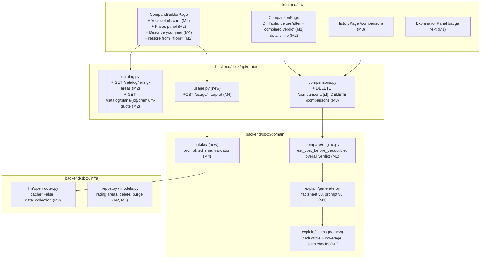
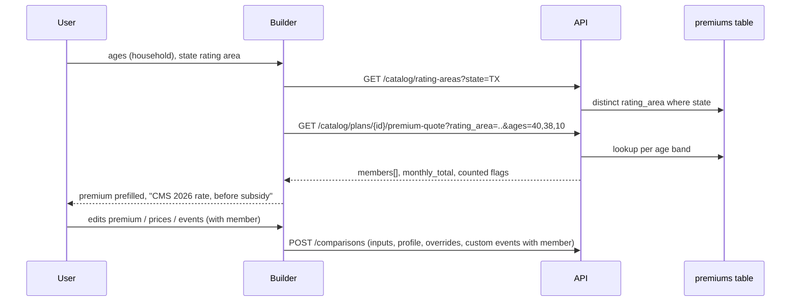
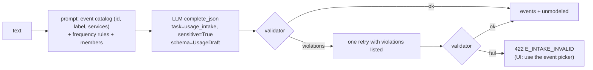

# 02 · Solution design

The v2 architecture stays as it is: `api → services → domain ← infra`, SQLite, FastAPI background tasks,
OpenRouter behind `LLMClient`, React + TanStack Query with types generated from OpenAPI. This plan adds
no new runtime dependency, service or datastore.

## 1. Component changes at a glance



## 2. M1 · Result accuracy

### 2.1 Before-deductible cost per use

For each cell (service or drug tier) and plan, the engine computes one more figure:

```
before(cs, key, allowed, plan) = Money(low, high) where for bound in (low, high):
    applies = resolve_applies(cs, key, bound, hints, visit=1)
    ded     = plan deductible for the tier/network (individual amount; family tier uses the individual
              amount too, because one use is one member's claim; 0 when has_deductible is False)
    pay     = member_pays(cs, allowed, ded_remaining=ded, bound=bound, applies=applies).amount
```

- `visit=1` keeps the catastrophic first-visits rule: the first primary care visit is before the deductible.
- A deductible smaller than `allowed` is handled by `member_pays` (pays `ded` then cost-sharing on the rest).
- Not-covered cells return `None` (as `est_per_use` does), so they stay "not comparable"; the coverage
  gap flag already covers them.
- The existing `est_cost_per_use` is unchanged and remains "once the deductible is met".

### 2.2 Combined verdict

```
tol = max(1.0, 0.02 * allowed)                       # unchanged tolerance
after  = verdict(base, other)                        # existing, point values
before = range_verdict(base.before, other.before):
    other.high + tol < base.low  -> better
    other.low  > base.high + tol -> worse
    |other.low - base.low| <= tol and |other.high - base.high| <= tol -> same
    otherwise -> not_comparable
overall:
    either estimate missing                 -> not_comparable
    after == before                         -> after
    {after, before} ⊆ {better, same}        -> better
    {after, before} ⊆ {worse, same}         -> worse
    otherwise                               -> depends_on_deductible
```

New enum `OverallVerdict = better | worse | same | depends_on_deductible | not_comparable`. The existing
`Verdict` enum and `verdicts` / `delta_per_use` fields stay for compatibility.

Worked example (F1 fixture, specialist visit, reference price $250 from `reference_prices.yaml`
version `2026.1-illustrative`): Moda (base) $120 copay, deductible doesn't apply → before
$120, after $120. Anthem 0% after deductible, catastrophic rules → before $250, after $0. `after = better`,
`before = worse` → **depends_on_deductible**.

### 2.3 Explanation inputs (fact sheet v3, prompt `explanation.v3`)

- `top_differences[].per_plan[k]` gets `cost_per_use_before_deductible` (`{low, high}`) and
  `cost_per_use_after_deductible` (renamed from `estimated_cost_per_use`), and the item gets
  `overall_verdict` per non-base plan.
- New `plans[].covered_before_deductible`: labels of all services and drug tiers whose
  `deductible_status ∈ {does_not_apply, before_per_sbc, first_visits_before}` (for `first_visits_before`
  the label gets " (first 3 visits)" or the plan's count).
- New `plans[].deductible_applies_to_everything_else: bool` = plan has a deductible and
  `covered_before_deductible` lists only preventive care (and first visits).
- Prompt rules added: don't say a plan makes you pay full cost until the deductible unless
  `deductible_applies_to_everything_else` is true; describe "depends on deductible" rows as such; don't
  say a service is covered or not covered unless `cost_sharing` says so.

### 2.4 Claim checker (`domain/explain/claims.py`)

Deterministic, run after the existing numeric, policy and superlative checks, on every sentence of
`headline`, `key_points`, `scenarios[].text` and `watch_out`. It works from the `ComparisonResult` (not
the fact sheet) so it sees every service.

| Rule | Trigger in a sentence that names exactly one plan (`_mentions`) | Violation when |
|---|---|---|
| C1 full-cost generalization | `full (cost\|price)` or `nothing (is )?covered` or `no coverage` followed within 60 chars by `deductible` | the plan covers any non-preventive service or drug before the deductible, and the sentence has no exception marker (`except`, `other than`, `apart from`, `besides`, `aside from`) |
| C2 deductible exemption | a service alias (§2.5) and one of `deductible (doesn't\|does not) apply`, `before (the\|its\|meeting the) deductible`, `without (meeting\|paying) the deductible`, `skips? the deductible`, `no deductible` | that plan's cell status for the service is not in the exempt set |
| C3 deductible required | a service alias and `after (the )?deductible` or `deductible applies` | the cell status is `does_not_apply` or `before_per_sbc` |
| C4 coverage | a service alias and `(does not\|doesn't\|won't) cover` or `not covered` | the cell's `covered` is not `False` |
| C5 coverage (positive) | a service alias and `covers` without negation | the cell's `covered` is `False` |

- Sentences matching the existing `_HEDGE` regex (`depend(s|ing)`, `overlap…`, `may`, `might`, `could`,
  `unclear`, `uncertain`) are skipped for C2–C5, as `claim_check` does today. C1 is not skipped by hedges:
  "you may pay full cost until the deductible" is still a generalization.
- When a sentence names two or more plans, C2–C5 apply to the plan named nearest before the service alias;
  C1 is skipped.
- Violations are reported in `GroundingReport.claim_violations` (existing field) with a rule prefix
  (`[C2] "<sentence>" — Specialist visit on Plan A: after deductible`), so retry feedback and the stored
  report need no schema change.

### 2.5 Service aliases

`claims.py` holds one alias table built from `SERVICE_LABELS` and `DRUG_LABELS` plus hand-written
aliases, e.g. `specialist(s)? (visits?)?` → `specialist_visit`, `primary care|PCP|doctor visits?` →
`primary_care_visit`, `urgent care`, `ER|emergency room`, `generic(s| drugs)?` → `drug:generic`,
`brand(-name)? drugs?` → `drug:preferred_brand`, `therapy|mental health` → `mental_health_outpatient`,
`physical therapy|rehab(ilitation)?` → `rehabilitation`. Ambiguous aliases map to no key and are skipped
(never guessed).

## 3. M2 · Personal cost inputs

### 3.1 Data flow



### 3.2 Rules

- Age to PUF band: `< 15 → "0-14"`, `15..63 → str(age)`, `≥ 64 → "64 and over"`.
- Household quote (D2): sort members by age descending; children are members under 21; only the 3 oldest
  children count; total = sum of counted members' rates. Members not found in the rate table → the quote
  returns `missing_ages` and no total.
- A premium field remembers its origin (`cms` or `user`). Changing ages or rating area re-fills only
  `cms` fields. The result page shows "Premium source: CMS 2026 rates, Rating Area 3, ages 40/38/10,
  before subsidy" when `profile` is present.
- Rating area selection is per state, because one comparison can mix states (the F1 fixture mixes TX
  and MO).
- Reference prices panel lists `GET /meta/reference-prices` values; only changed values are sent as
  `reference_price_overrides`; the engine already applies them (`with_overrides`).
- Restore (`/compare?from=<cid>`): the builder loads the comparison, replaces the selection tray with its
  plans (labels from `result.plans`), and sets every form field from `request`.

## 4. M3 · Privacy controls

- **Delete:** `DELETE /comparisons/{id}` and `DELETE /comparisons` (all). Rows are hard-deleted (single-user
  local app; no backups exist to reconcile).
- **Retention:** `Settings.comparison_retention_days: int | None = None`. When set, `init_db()` startup and
  `sbcx purge-comparisons` delete rows older than N days.
- **LLM privacy:** `LLMClient.complete_json` gains `cache: bool = True` and `sensitive: bool = False`.
  `sensitive=True` forces `cache=False` and adds `"data_collection": "deny"` to the OpenRouter `provider`
  object (verify the parameter name against OpenRouter docs in T3.4; A5). The intake task always sets
  `sensitive=True`.
- **Logs:** the request-logging middleware and `llm_call` records must never include request bodies,
  prompts or outputs. A test asserts this for the intake route.
- **Notice text** in the builder: what is stored (the confirmed events, ages and premiums, as part of the
  saved comparison), what is sent to the LLM (only the description, when the user presses Interpret), and
  how to delete it (history page).

## 5. M4 · Natural-language usage intake

### 5.1 Why this shape

One constrained call, validated, then confirmed by the user. Nothing about the task needs planning,
retrieval or multiple tool calls: the input is a short text, the output vocabulary is fixed (18 event
types in `scenarios.yaml`), and the user is the final check. An agent would add cost and failure modes
without improving the result.

### 5.2 Contract

```
POST /api/v1/usage/interpret
  { "text": str (1..1000 chars), "coverage_tier": "individual" | "family", "members": [str] (≤ 10 labels, optional) }
200 { "events": [ { "event": <event type id>, "count": int 1..365, "member": int 0..9,
                    "quote": str, "basis": str } ],
      "unmodeled": [ { "quote": str, "reason": str } ],
      "warnings": [str], "model": str }
503 E_LLM_UNAVAILABLE when no LLM is configured or the budget is spent
404 E_NOT_FOUND when SBCX_INTAKE_ENABLED is false
GET /api/v1/health gains "intake_available": bool = intake_enabled and llm_configured; the UI shows the
feature only when it is true
422 E_INTAKE_INVALID when the model output fails validation twice
```

### 5.3 Processing



Validator rules:
1. `event` is a key of `event_types`; `member` < number of members (0 for individual).
2. `quote` is a case-insensitive substring of the input text (after whitespace normalization). This is
   the grounding rule: no event without words the user wrote.
3. `count` is 1..365, and is one of: a number written in `quote` (digits or the number words in
   `grounding.WORDS`); a value from the frequency table applied to the quote (`daily` 365; `weekly`,
   `every week`, `once a week` 52; `every other week`, `biweekly`, `every two weeks` 26; `twice a month`
   24; `monthly`, `every month`, `each month`, `once a month` 12; `every other month` 6; `quarterly`,
   `every 3 months`, `every three months` 4; `twice a year`, `every 6 months`, `every six months` 2;
   `yearly`, `annually`, `once a year` 1); `N × 52 / 12 / 1` for "N times a week / month / year"
   ("3 times a week" = 156); or 1 when the quote has neither a number nor a frequency. Any other count
   is a violation.
4. Duplicate (event, member) pairs are merged by summing counts.
5. Conditions without a stated use ("I have diabetes") must go to `unmodeled`, which the prompt requires
   and the validator can't check; the eval set measures it.

### 5.4 Model and cost

`SBCX_MODEL_INTAKE` (default `deepseek/deepseek-v4-flash`, same as other tasks). Prompt ≈ 1.5k tokens,
output ≈ 300 tokens; expected cost is in the range of the explanation call (≈ $0.0005), to be confirmed
in T4.6.

## 6. Error handling, logging, monitoring

| Area | Behavior |
|---|---|
| Engine | New fields are optional on read (`None` / `{}` defaults) so stored 1.2.0 results still validate |
| Explanation | Same flow: violations → one retry with the list → template; template now also passes C1–C5 (tested) |
| Premium quote | Missing ages → `missing_ages`; missing plan → 404 `E_NOT_FOUND`; no premiums loaded → empty `rating-areas` and the UI hides the details card |
| Intake | `LLMError` → 503 `E_LLM_UNAVAILABLE`; validation failure after retry → 422; budget exhausted → 503 |
| Metrics | `llm_calls` gets the new task `usage_intake`; `/meta/usage` reports it. Explanation `source` and `claim_violations` are already stored per comparison, so fallback and violation rates can be queried |

## 7. Security and access

- Single-user local app; no authentication exists or is added. The new delete endpoints are as exposed as
  the existing ones; this is acceptable only while the app is local (RK7).
- Input limits: intake text ≤ 1,000 chars (Pydantic), ages 0–120 and ≤ 10 members, rating area ≤ 32 chars.
- The intake prompt is built with the user text in a delimited block; output is schema-constrained and
  validated, so prompt injection can at worst produce event rows the user sees and can delete.

## 8. Performance and maintainability

- Engine work per comparison grows by one `member_pays` call per bound per cell (≈ 30 cells × 5 plans × 2),
  negligible next to `simulate`. The existing < 200 ms target stays.
- `rating-areas` is a `DISTINCT` over ≈ 227k premium rows filtered by state; add an index on
  `premiums(state, rating_area)` if it exceeds 50 ms (T2.1 measures it).
- No new libraries. Claim aliases live in one table in `claims.py`; event frequency words in one table in
  `domain/intake/rules.py`.

## 9. Key design decisions

| # | Decision | Alternative rejected | Why |
|---|---|---|---|
| KD1 | Add fields rather than change `Verdict` semantics | Redefine `verdicts` as before-deductible | Keeps stored results, types and tests valid |
| KD2 | Rule-based claim checks | LLM-as-judge | Deterministic, free, testable; the fact data already exists |
| KD3 | Checker reads `ComparisonResult` | Read the fact sheet | The fact sheet holds only the top 8 differences |
| KD4 | Household quote computed in the backend | Sum in the browser | Child rule tested in Python, one source of truth |
| KD5 | Intake is a single validated call + user confirmation | Agent, multi-turn interview | Fixed vocabulary, short input; user is the final check |
| KD6 | Privacy controls before intake | Ship intake first | Intake adds health free text; F10 already a gap |
