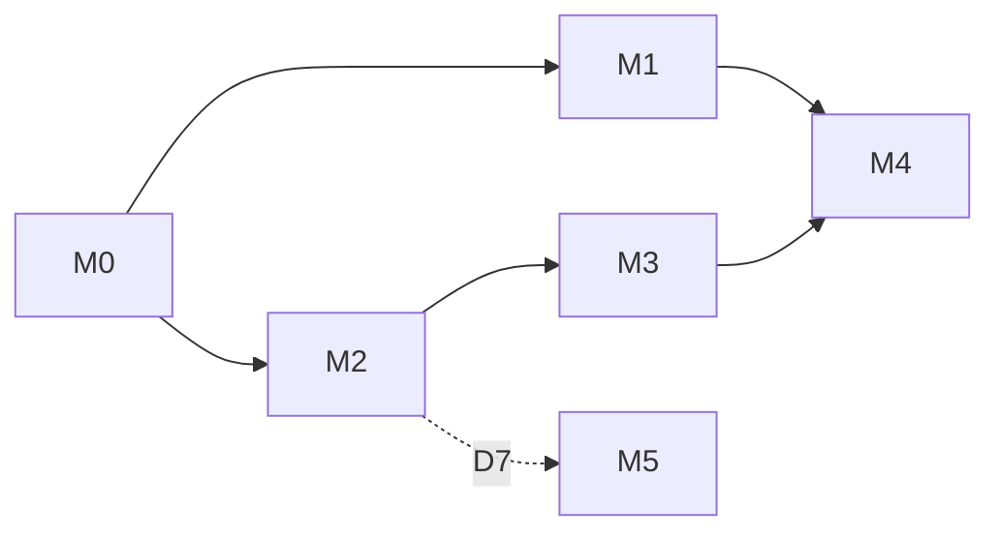

# 05 · Milestone plan

Each milestone ends in a working app with a testable outcome. Milestones merge to `main` one at a time
through a PR each (or one PR per task group where noted); nothing is released half-done behind the user.

## Sequencing and parallel work

| Can run in parallel | Must be sequential |
|---|---|
| M1 and M2 (different files except `domain/comparison.py`; both add fields there, so merge one before the other's API regeneration) | T1.1 → T1.2 → T1.3; T1.5 → T1.6 → T1.7 |
| T0.2 (human labeling) alongside T1.1–T1.5 | T2.1 + T2.2 + T2.3 → T2.4 → T2.5 → T2.7 |
| T2.6 (prices panel) alongside T2.1–T2.3 | T3.4 → T4.3 → T4.4 → T4.5 |
| T3.1–T3.3 alongside late M2 | T4.1 (human) and T4.3 → T4.6 → enable intake |
| T4.1, T4.2 alongside M3 | M5 only after M2 and D7 |

Human-only steps: T0.2 labeling, T4.1 case writing, the decisions D1–D9, and the live checks in T1.9
and T4.6 (they spend OpenRouter credit and need a reviewer).

---

## M0 · Baseline and fixtures

| | |
|---|---|
| Objective | Lock the discovery baseline and build the fixtures M1 tests rely on |
| Tasks | T0.1, T0.2, T0.3 |
| Prerequisites | Local DB with comparison `f8c68687…` and the two catalog plans (present today) |
| Deliverables | `backend/tests/fixtures/*`, `eval/explanations/sentences.jsonl`, baseline row in the backlog |
| Acceptance | Fixture comparison reproduces stored totals; labeled set committed |
| Testing | `make test` green; new fixture test |
| Exit criteria | Baseline numbers confirmed or differences explained; D1 and D6 decided |

## M1 · Result accuracy

| | |
|---|---|
| Objective | The comparison screen no longer shows deductible-blind verdicts, and explanations can't state false deductible or coverage facts |
| Tasks | T1.1–T1.9 (T1.8 is SHOULD) |
| Prerequisites | M0; D1, D6, D8 |
| Deliverables | Engine 1.3.0, prompt explanation.v3, `claims.py`, updated table and badge, audit note |
| Acceptance | R-ACC-1..8 met |
| Testing | Unit (verdicts, claims, fact sheet), property, integration (stored 1.2.0 results), vitest (old and new fixtures), E2E unchanged and green, live check T1.9 |
| Exit criteria | F1 fixture: no misleading "lower cost"; F2 sentence rejected; claim-check precision ≥ 0.9 and recall 1.0 on the labeled set; template fallbacks ≤ 1 of 10 live cases; scenario totals unchanged on all fixtures |

## M2 · Personal cost inputs

| | |
|---|---|
| Objective | Comparisons use the user's ages, rating area, household, usage per member and prices, and can be edited without retyping |
| Tasks | T2.1–T2.7 |
| Prerequisites | M0; D2 (child rule), D3 |
| Deliverables | 2 read endpoints, `ComparisonRequest.profile`, builder details card, per-member events, prices panel, restore flow |
| Acceptance | R-PER-1..9 met |
| Testing | Unit (age band, child rule, form round trip, prefill), integration (endpoints), vitest, Playwright edit-and-recompare step, latency check |
| Exit criteria | Premiums follow age and rating area; restored comparison reproduces `result_hash`; all existing tests green |

## M3 · Privacy controls and history

| | |
|---|---|
| Objective | Users can see and delete what's stored; sensitive LLM calls aren't cached or collected |
| Tasks | T3.1–T3.5 |
| Prerequisites | M2 (profile now stored); D4, D5, D9 |
| Deliverables | Delete endpoints, Saved page, retention purge, `sensitive` LLM flag, log test, notice text, PRD privacy row updated |
| Acceptance | R-PRV-1..8 met |
| Testing | Integration (delete, purge), unit (LLM payload, cache untouched), log-capture test, vitest |
| Exit criteria | Log test green; delete-all leaves zero comparisons; OpenRouter parameter verified (A5) |

## M4 · Natural-language usage intake

| | |
|---|---|
| Objective | Users can describe their year in words and confirm the resulting events |
| Tasks | T4.1–T4.6 |
| Prerequisites | M1 (prompt and grounding conventions), M3 (sensitive calls), T2.5 (member select); D5, D6 |
| Deliverables | `domain/intake/`, `services/usage.py`, `POST /usage/interpret`, builder component, eval set and report |
| Acceptance | R-INT-1..7 met |
| Testing | Unit (validator, frequency table), service tests (fake LLM), integration, vitest, Playwright with fake LLM, live eval T4.6, log test re-run |
| Exit criteria | Eval targets met (D6) → `SBCX_INTAKE_ENABLED` default true; otherwise the feature ships disabled and the gap is logged |

## M5 · Cost-ranked catalog (deferred by D7; revisit after M2)

| | |
|---|---|
| Objective | Shoppers can sort the catalog by estimated yearly cost for their details |
| Tasks | T5.1, T5.2 |
| Prerequisites | M2; D7 = yes |
| Deliverables | `POST /catalog/rank`, catalog sort option |
| Acceptance | R-RNK-1..4 met |
| Testing | Integration, timing on real data, vitest |
| Exit criteria | TX ranking < 2 s; ranges visible in the list |
