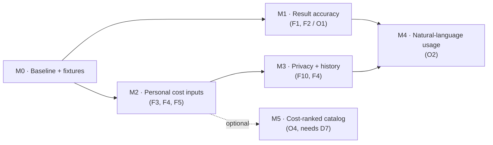

# Plan v2.1: trustworthy results, personal inputs, natural-language usage

**Status:** M0–M4 implemented (2026-10-29), see the [backlog and progress log](08-backlog.md). Open: human
labeling of the explanation sentences (B-03) and review of the intake eval set (B-25), after which "Describe
your year" can be enabled by default. M5 is deferred (D7).

**Source of truth:** the discovery and feasibility analysis of 2026-10-29
([summary and baseline](00-discovery-baseline.md)). Every work item here traces to a finding (F#) or an
opportunity (O#) from that analysis.

**In one sentence:** first fix what the comparison screen tells users (per-service verdicts and
explanation claims about deductibles and coverage), then make the numbers personal (age, rating area,
household, editable prices, editable comparisons), then add privacy controls, and only then add the one
AI feature the analysis supports: describing a year of care in plain words.

## Documents

| # | Document | What's in it |
|---|---|---|
| 00 | [Discovery baseline](00-discovery-baseline.md) | Findings used, corrections, measured baseline |
| 01 | [Scope](01-scope.md) | Selected opportunities, rationale, exclusions, decisions needed |
| 02 | [Solution design](02-solution-design.md) | Architecture changes, data flow, contracts, AI component, security, observability |
| 03 | [Specification](03-specification.md) | Functional and technical requirements per opportunity |
| 04 | [Task breakdown](04-task-breakdown.md) | Every task with objective, files, behavior, dependencies, acceptance, tests, done |
| 05 | [Milestones](05-milestones.md) | M0–M5 with prerequisites, deliverables, exit criteria, parallel work |
| 06 | [Testing strategy](06-testing-strategy.md) | Test layers, AI evaluation, quality gates, regression protection |
| 07 | [Risk register](07-risk-register.md) | Risks, assumptions, dependencies, mitigations |
| 08 | [Backlog](08-backlog.md) | Ordered backlog for a coding agent, with ready/blocked state |

## Conventions

- Follows `docs/design/v2/`: numbered documents, Mermaid diagrams, ADR-style decisions.
- Task IDs: `T<milestone>.<n>` (e.g. `T1.3`). Requirement IDs: `R-<area>-<n>` (e.g. `R-ACC-2`).
  Decisions: `D<n>`. Risks: `RK<n>`. Assumptions: `A<n>`.
- Paths are relative to the repo root. Backend code lives in `backend/sbcx/`, frontend in `frontend/src/`.
- Version bumps follow `backend/sbcx/versions.py` (engine, prompts) so stored artifacts stay traceable.
- Progress is tracked in [08-backlog.md](08-backlog.md) and, once work starts, as a new section in
  `IMPLEMENTATION_ROADMAP.md` (same status legend).
