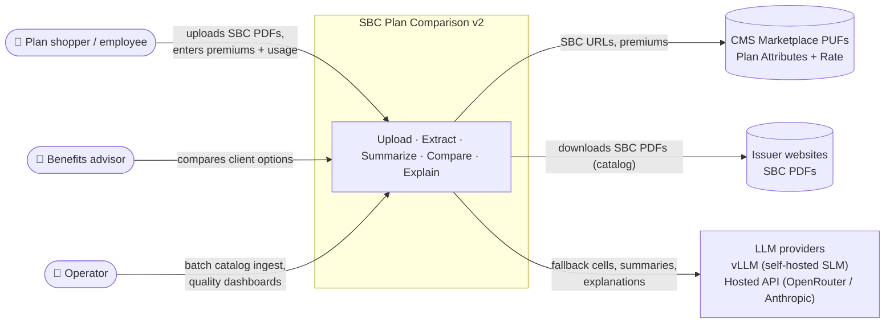
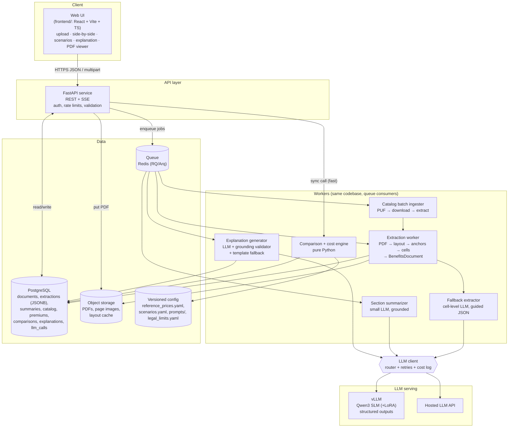
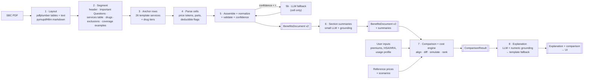
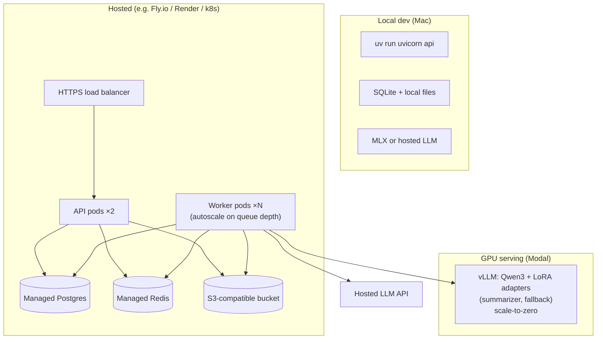

# Architecture: SBC Plan Comparison v2

Diagrams are Mermaid and render on GitHub. Detail per component is in [03-HLD](03-HLD.md)
and [04-LLD](04-LLD.md).

## 1. Architectural principles

1. **Deterministic core, probabilistic edges.** Parsing, normalization, validation, comparison
   and money math are plain Python. LLMs are only at the edges: re-reading ambiguous cells,
   writing summaries, writing the explanation.
2. **LLM output is never trusted blindly.** Every LLM output passes a schema check and a
   grounding check against the data it was given. Every LLM step has a non-LLM fallback.
3. **One contract per boundary.** `BenefitsDocument` (extraction → everything else) and
   `ComparisonResult` (engine → explanation/UI). Both are versioned Pydantic models.
4. **Provenance everywhere.** Every value carries where it came from (page, cell text,
   parser rule, or LLM fallback).
5. **Cache by content.** Documents are keyed by SHA-256. Extraction, summaries and catalog
   entries are computed once per (hash, version).
6. **Provider-agnostic LLM layer.** One client interface over vLLM (self-hosted SLM),
   OpenRouter and Anthropic, all using the OpenAI-compatible or native structured-output APIs.

## 2. System context (C4 level 1)

## 3. Containers (C4 level 2)

**Why the comparison engine runs synchronously in the API:** it's pure CPU work on two to five
small JSON documents (< 200 ms), so queueing it would only add latency. Extraction and
LLM steps take seconds and go through the queue.

## 4. End-to-end data flow

## 5. Where LLMs are used (and where they are not)

| Step | LLM? | Model class | Input size | Why |
|---|---|---|---|---|
| Layout, segmentation, anchoring, cell parsing | No | — | — | Fixed CMS template; regex + table structure is exact and fast |
| Cell fallback | Yes, ≤ 10% of docs, few cells each | OpenRouter (configurable, `SBCX_MODEL_FALLBACK`) | ~150 tokens/cell | Long-tail cell wording the rules don't cover |
| Section summaries | Yes, 13 calls/doc (parallel), cached | OpenRouter (`SBCX_MODEL_SUMMARY`) | ~300–600 tokens/section | Turns limitations text into readable sentences |
| Comparison, cost simulation, ranking | **No** | — | — | Money math must be exact and auditable |
| Explanation | Yes, 1 call per comparison | OpenRouter (`SBCX_MODEL_EXPLANATION`) | ~2–4k tokens | Narrative quality matters most here |

## 6. Deployment view

- **MVP:** single container (API + in-process worker via FastAPI background tasks), SQLite,
  local disk, hosted LLM. No GPU needed.
- **Scale-up:** split workers, Postgres, Redis queue, Modal vLLM for the SLM (matches the
  existing Phase 5–6 plan in [00-compute-plan](../../00-compute-plan.md)).

## 7. Mapping to the current repository

| Existing asset | Role in v2 |
|---|---|
| `src/schema.py` (`SBCExtraction`, `normalize`) | Core of `BenefitsDocument.benefits`; unchanged field paths, so `eval/score.py` keeps working |
| `audit_tools/ext.py`, `mk.py`, `excl.py`, `parse.py`, `tables.py`, `mdclean.py` | Prototype for the parser. Ported into `src/sbcx/parse/` with tests |
| `audit_tools/fix/*.txt` + `data/labels/v1.4/_corrections.jsonl` | Catalog of parser failure patterns. Each pattern becomes a rule + a regression test |
| `data/labels/v1.4` (1,829 docs, 450 + 105 reviewed) | Parser regression corpus |
| `data/gold` (10 docs, PDF-verified) | Acceptance test set (unchanged) |
| `eval/score.py` | Scores parser output exactly like model output |
| `src/collect_sbcs.py`, `download_split.py` | Catalog batch ingester inputs |
| `training/*` (QLoRA, vLLM eval) | Retargeted to cell-fallback + summarizer SLMs ([09-decisions](09-decisions.md) ADR-009) |
