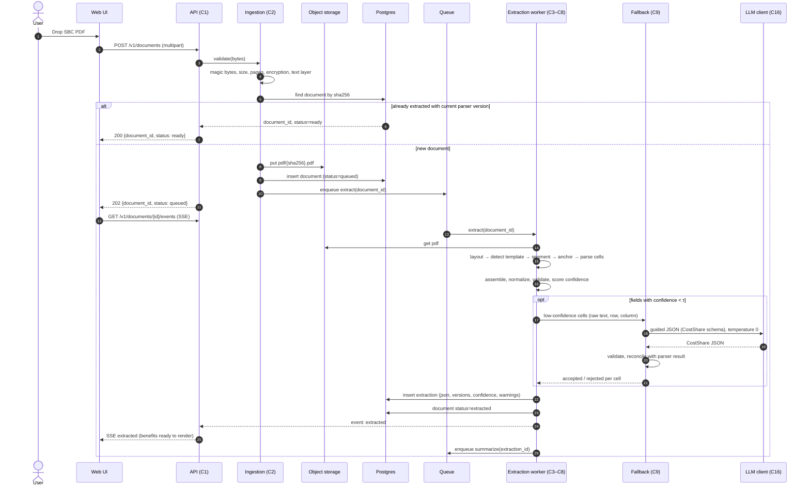
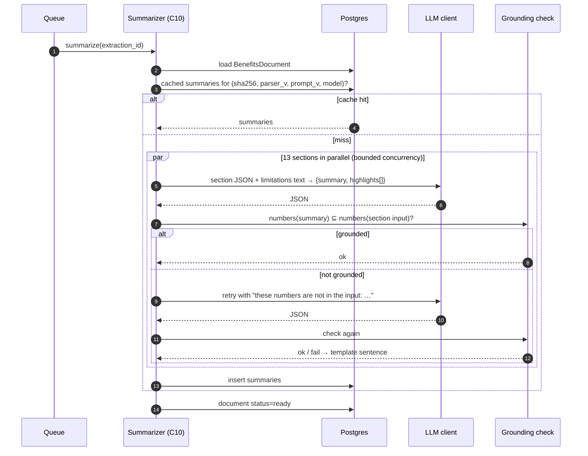
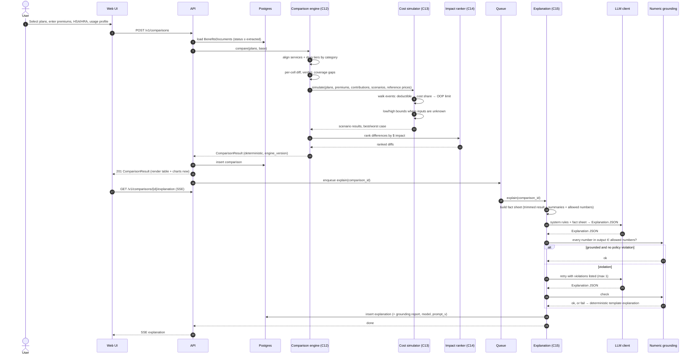
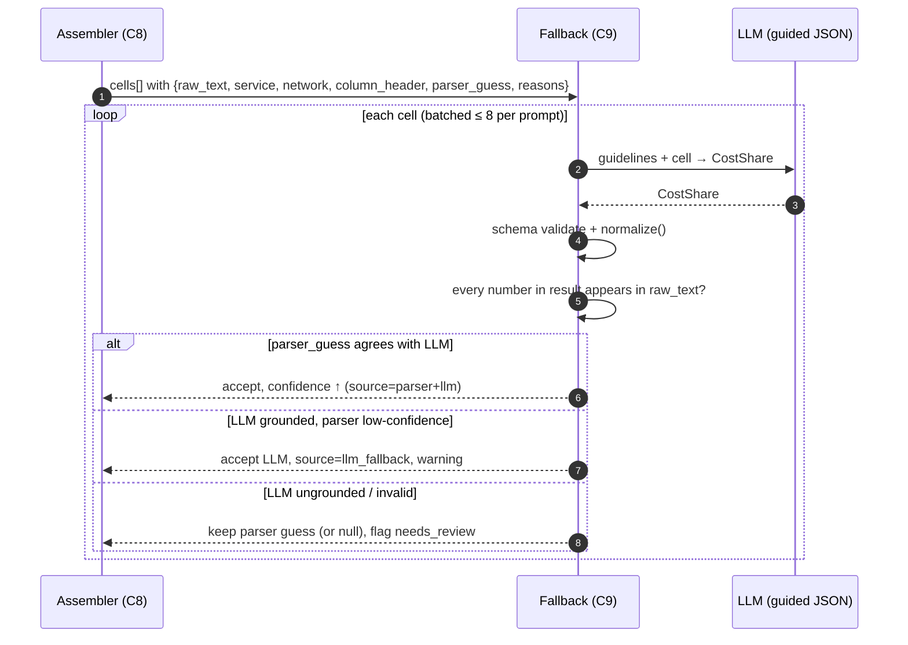
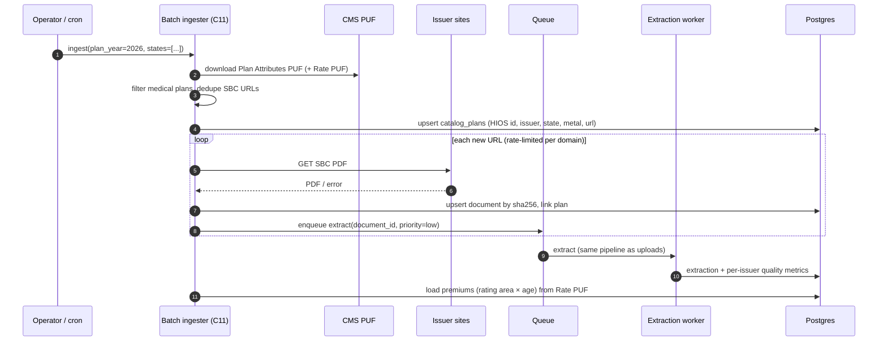
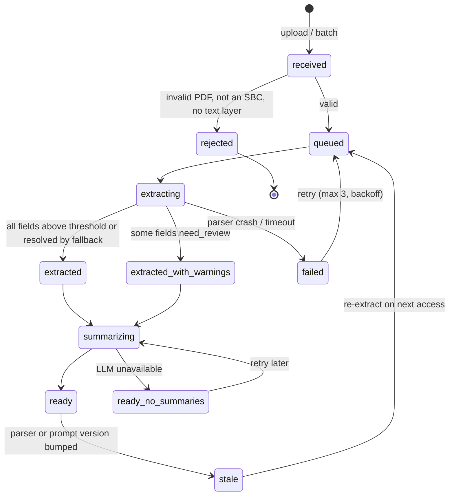

# High-Level Design: SBC Plan Comparison v2

Scope: components, their responsibilities and interfaces, main flows (sequence diagrams),
lifecycle, failure handling, and cross-cutting concerns. Algorithms and code layout are in
[04-LLD](04-LLD.md). Schemas are in [05-data-contracts](05-data-contracts.md).

## 1. Components

| # | Component | Responsibility | In | Out | LLM |
|---|---|---|---|---|---|
| C1 | **API gateway** (FastAPI) | Upload, job status, comparison requests, SSE streams, auth, rate limits | HTTP | JSON / SSE | — |
| C2 | **Ingestion** | Validate PDF, SHA-256 dedupe, store in object storage, enqueue | PDF bytes | `document_id` | — |
| C3 | **Layout extractor** | Per page: tables (pdfplumber), words with coordinates, text; markdown (pymupdf4llm) as second view | PDF | `LayoutDoc` | — |
| C4 | **Template detector** | Confirm CMS SBC template, detect variant (IHCP columns, tiered networks, 3+ price columns) | `LayoutDoc` | `TemplateProfile` | — |
| C5 | **Section segmenter** | Split into header, Important Questions, services table, drug rows, exclusions/other covered, coverage examples | `LayoutDoc` | `Sections` | — |
| C6 | **Row anchorer** | Map table rows to the 26 template services (in order) and drug tiers; classify price columns | `Sections` | `AnchoredRows` | — |
| C7 | **Cell parser** | Turn a price cell into `CostShare` (copay, coinsurance, deductible flag, note) using the v1.4 rules | cell text + context | `CostShare` + rule trace | — |
| C8 | **Assembler + validator** | Build `SBCExtraction`, apply `normalize()`, business rules, compute per-field confidence | parsed parts | `BenefitsDocument` (draft) | — |
| C9 | **Fallback extractor** | Re-extract low-confidence cells with a small LLM under JSON-schema guided decoding; reconcile | cell text + row/column labels | `CostShare` | Small |
| C10 | **Section summarizer** | 13 grounded plain-language summaries per document | section JSON + limitations text | `SectionSummary[]` | Small |
| C11 | **Plan catalog** | Store catalog plans (PUF metadata + extraction), search, premiums from Rate PUF | PUF CSVs | catalog rows | — |
| C12 | **Comparison engine** | Align plans, per-service diffs, verdicts, coverage gaps, drug tier mapping | `BenefitsDocument[]` | diffs | — |
| C13 | **Cost simulator** | Annual cost per plan per scenario; best/worst case; uncertainty bounds | plans + premiums + scenario + reference prices | `ScenarioResult[]` | — |
| C14 | **Impact ranker** | Order differences by estimated $ impact for the user's profile | diffs + scenario results | ranked list | — |
| C15 | **Explanation generator** | Prompt LLM with the trimmed `ComparisonResult`, validate grounding, retry, template fallback | `ComparisonResult` | `Explanation` | Mid |
| C16 | **LLM client** | Provider routing, structured outputs, retries, timeouts, cost/latency logging, caching | prompt + schema | parsed JSON | — |
| C17 | **Persistence** | Postgres (JSONB) + object storage; repositories per aggregate | — | — | — |
| C18 | **Observability** | Structured logs, metrics, traces, quality dashboards | events | dashboards | — |

## 2. Main flows

### 2.1 Upload and extract one SBC

### 2.2 Section summaries

### 2.3 Compare plans and explain

### 2.4 Cell-level fallback detail

### 2.5 Catalog batch ingestion (P1)

## 3. Document lifecycle

Comparison is allowed from `extracted` onwards. Summaries are nice-to-have and don't block comparison.

## 4. Key design decisions (summary)

Full rationale in [09-decisions](09-decisions.md).

| Decision | Choice | Main reason |
|---|---|---|
| Extraction method | Template-anchored rules, LLM only per low-confidence cell | Fixed CMS template; prototype already works; ~1000× faster than LLM generation |
| Schema | `BenefitsDocument v2` wraps unchanged v1 `SBCExtraction` + provenance | Keep 1,829 labels and the scorer valid |
| Money math | Deterministic simulator | LLM arithmetic isn't reliable or auditable |
| Explanation safety | Numeric grounding validator + template fallback | A wrong dollar figure is the worst failure |
| Unknown inputs | Ranges with stated assumptions | Don't hide uncertainty (same philosophy as three-valued flags in v1) |
| Premiums | User input; Rate PUF for catalog | Not in the SBC |
| Storage | Postgres JSONB (SQLite in MVP) | Simple, queryable, versioned JSON |

## 5. Failure handling and degradation

| Failure | Detection | Behavior |
|---|---|---|
| Invalid / encrypted / huge PDF | Ingestion checks | 422 with reason |
| No text layer (scanned) | < N characters per page | 422 "scanned SBC not supported yet" (OCR later) |
| Not an SBC template | Template detector score < threshold | 422 with "doesn't look like an SBC" |
| Unknown layout variant | Anchoring finds < 20 of 26 services | Extract what's possible; send missing rows to fallback; status `extracted_with_warnings` |
| LLM provider down / timeout | Client timeout, circuit breaker | Fallback cells stay parser guess + `needs_review`; summaries skipped; template explanation |
| LLM returns ungrounded numbers | Grounding validator | Retry once; then template |
| Business-rule violation (e.g. OOP < deductible) | Validator | Keep values, add warning, lower confidence, show in UI |
| Comparison of incompatible items (copay vs coinsurance) | Engine | Convert via reference price; mark `estimated`; else `not_comparable` |
| Version drift | Stored parser/engine/prompt versions | Mark stale; recompute lazily |

## 6. Cross-cutting concerns

### 6.1 Security and privacy

- Uploads: size and page limits, PDF parsed in a worker process with CPU/memory/time limits (pdfplumber on hostile PDFs can be slow).
- Usage profiles can imply health conditions (e.g. "pregnancy", "insulin"). Stored per session; persisted only on opt-in; never written to logs; sent to LLM providers only with no user identifiers and with providers configured for zero data retention where available.
- Prompt injection: SBC text reaches LLMs only in the fallback (one cell) and summarizer (one section). Both use strict JSON schemas and grounding checks, so injected text can't produce numbers that aren't in the source. The explanation LLM never sees raw PDF text, only the summaries, which already passed grounding.
- Secrets in env / secret manager (current `.env` pattern for dev only).

### 6.2 Observability

| Signal | Examples |
|---|---|
| Metrics | stage latency (layout, anchor, parse, fallback, summarize, compare, explain); fallback rate per issuer; grounding failure rate; template-fallback rate; LLM tokens and $ per request |
| Logs | structured JSON with `document_id`, `comparison_id`, versions; no profile data |
| Traces | OpenTelemetry spans per stage |
| Quality dashboard | per-issuer: anchored services out of 26, mean confidence, fallback cells, warnings; nightly gold + v1.4 regression score |

### 6.3 Versioning

Every artifact stores the versions that produced it: `parser_version`, `schema_version`,
`engine_version`, `prompt_version`, `model_id`, `reference_prices_version`. Same inputs and
versions → same outputs (LLM steps use temperature 0 and are cached).

### 6.4 Performance and capacity

| Stage | Expected time | Notes |
|---|---|---|
| Layout (pdfplumber, 8 pages) | 0.5–1.5 s | Biggest deterministic cost; cache layout JSON per hash |
| Anchor + parse + assemble | < 100 ms | Pure Python regex |
| Fallback (when needed) | 1–4 s | Batched cells, small model |
| Summaries | 3–8 s | 13 parallel calls, cached forever per hash/version |
| Comparison + simulation | < 200 ms | 5 plans × 5 scenarios × ~50 events |
| Explanation | 5–12 s | One mid-size call, ~3k in / ~700 out tokens |

Catalog: 14,476 SBCs × ~1.5 s CPU ≈ 6 CPU-hours for extraction; LLM cost is dominated by
summaries (~13 × 500 tokens/doc), cents per hundred docs on a small model.

## 7. Technology choices

| Concern | Choice | Alternatives considered |
|---|---|---|
| PDF tables | pdfplumber (primary), pymupdf4llm markdown (secondary view) | Camelot, Docling (heavier; candidate for coverage examples) |
| Schemas | Pydantic v2 | dataclasses + jsonschema |
| API | FastAPI + SSE | Flask |
| Queue | Arq/RQ on Redis; FastAPI BackgroundTasks for MVP | Celery (heavier) |
| DB | Postgres 16 JSONB; SQLite for MVP | Mongo |
| LLM serving | vLLM with structured outputs (self-hosted SLM), hosted API via OpenAI-compatible client | TGI, llama.cpp |
| UI | Streamlit for MVP → Next.js | Gradio |
| Testing | pytest, hypothesis (property tests for cost engine), syrupy snapshots | — |
