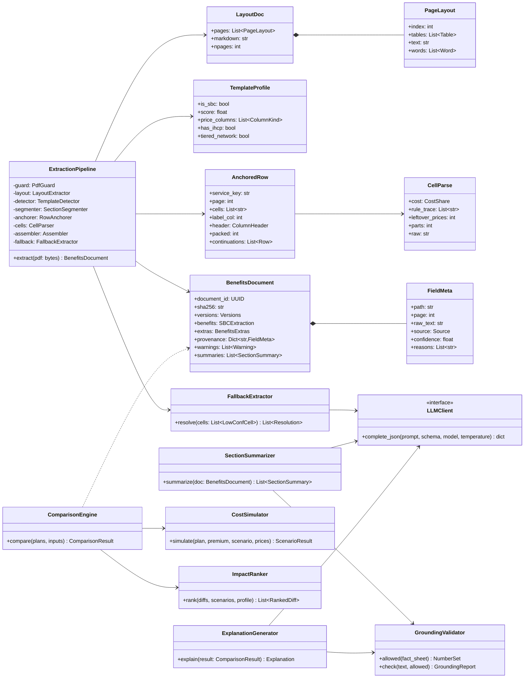
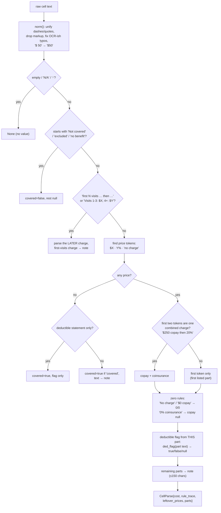
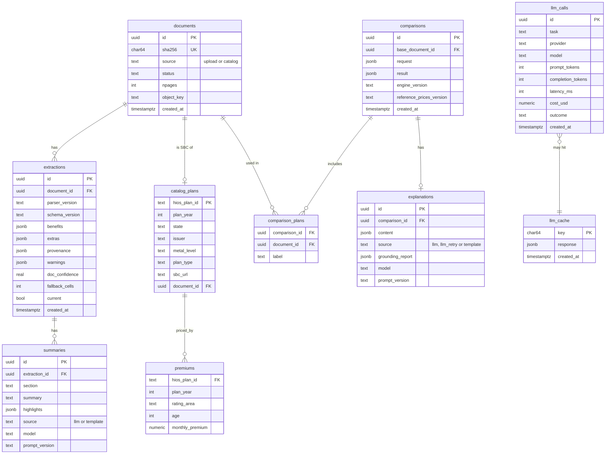

# Low-Level Design: SBC Plan Comparison v2

Covers code layout, classes, algorithms, prompts, API, database and config. Data contracts
are in [05-data-contracts](05-data-contracts.md); the cost math is in [06-cost-model](06-cost-model.md).

## 1. Package layout

New code goes into one package, `src/sbcx/`. Existing scripts in `src/` (collection,
labeling, splits) stay as they are; `src/schema.py` is imported, not copied.

```
src/sbcx/
  __init__.py
  versions.py                 # PARSER_VERSION, ENGINE_VERSION, SCHEMA_VERSION
  config.py                   # pydantic-settings: thresholds, providers, paths
  schema/
    benefits.py               # BenefitsDocument v2 (wraps schema.SBCExtraction)
    comparison.py             # ComparisonResult, ScenarioResult, Diff
    explanation.py            # Explanation, SectionSummary
  ingest/
    pdf_guard.py              # magic bytes, size, pages, encryption, text layer
    store.py                  # sha256, object storage put/get
  parse/                      # deterministic extractor (ported from audit_tools/)
    layout.py                 # pdfplumber tables/words + pymupdf4llm markdown → LayoutDoc
    textnorm.py               # norm(), dejunk(), OCR-ish fixes (from ext.py)
    template.py               # SBC detection + TemplateProfile (IHCP, tiers, columns)
    sections.py               # segmenter
    header.py                 # plan_name, issuer, plan_type, coverage_period
    questions.py              # Important Questions: deductible, OOP, referral, before-deductible list
    anchors.py                # 26-service row anchoring + drug rows (from ext.py extract())
    columns.py                # column kind classification (colkinds)
    cells.py                  # parse_cost(), ded_flag() (from ext.py)
    drugs.py                  # drug tier rows → DrugTier, category from label
    lists.py                  # excluded / other covered services (from excl.py)
    examples.py               # coverage examples Peg/Joe/Mia (P1)
  extract/
    pipeline.py               # extract(pdf_bytes) -> BenefitsDocument
    assemble.py               # parts → SBCExtraction + Provenance
    rules.py                  # business-rule validation → warnings
    confidence.py             # per-field confidence
    fallback.py               # cell-level LLM fallback + reconciliation
  enrich/
    sections_map.py           # section → JSON paths
    summarize.py              # SectionSummarizer
  compare/
    align.py                  # service + drug tier alignment
    diff.py                   # per-cell diffs + verdicts
    cost_model.py             # CostShareCalculator, Accumulators, simulate()
    scenarios.py              # load scenarios.yaml, custom profile → events
    reference_prices.py       # load + override reference allowed amounts
    rank.py                   # impact ranking
    engine.py                 # compare(plans, inputs) -> ComparisonResult
  explain/
    factsheet.py              # trimmed ComparisonResult + allowed numbers
    generate.py               # ExplanationGenerator
    grounding.py              # number extraction + checks (shared with summarizer)
    policy.py                 # banned phrases / advice checks
    templates/explanation.md.j2
  llm/
    client.py                 # LLMClient protocol + providers
    providers/{vllm.py, openrouter.py, anthropic.py}
    cache.py                  # (prompt hash, model) → response
  store/
    models.py                 # SQLAlchemy tables
    repo.py                   # repositories
  api/
    main.py                   # FastAPI app
    routes/{documents.py, comparisons.py, catalog.py}
    sse.py
  workers/
    tasks.py                  # extract, summarize, explain, ingest_catalog
config/
  reference_prices.yaml
  scenarios.yaml
  legal_limits.yaml           # per plan year OOP maximums
  prompts/{fallback.v1.md, summary.v1.md, explanation.v1.md}
tests/
  unit/ …  property/ …  regression/ (gold + v1.4)  snapshots/
```

## 2. Core classes



## 3. Deterministic extractor

### 3.1 Layout (`parse/layout.py`)

- Two views of the same PDF, because each fails differently (seen in `audit_tools/`):
  - **Table view** — `pdfplumber` `page.extract_tables()` per page (first 12 pages), cells
    with `\n` kept as `<br>`. Best for cell boundaries.
  - **Markdown view** — `pymupdf4llm` (the existing `src/pdf_to_markdown.py`) then the
    `mdclean.py` repair: strip `~~`/`<mark>`, and split run-together tokens (`deductibledoes`)
    by checking against PDF word bigrams. Best for header text and lists.
- `EXTSRC` in `ext.py` switched between them; v2 runs **both** and the anchorer
  picks the view per row by score (more anchored services, fewer leftover price tokens).
  Disagreement between views lowers confidence (§3.8).
- Output cached as JSON in object storage at `layout/{sha256}.json`.

### 3.2 Template detection (`parse/template.py`)

Score = weighted sum of signals found in the first 3 pages:

| Signal | Weight |
|---|---|
| "Summary of Benefits and Coverage" in header | 0.30 |
| "Important Questions" + "Why This Matters" table | 0.25 |
| "Common Medical Event" + "Services You May Need" header | 0.25 |
| ≥ 10 of the 26 service regexes match row labels | 0.20 |

`is_sbc = score ≥ 0.6`. The profile also records column kinds from the header rows
(`colkinds()` in `ext.py`): `in`, `in_tier2`, `oon`, `ihcp`, `nonihcp`, `limits`.

### 3.3 Row anchoring (`parse/anchors.py`)

The 26 services appear in a fixed order in every SBC. The anchorer walks table rows and
matches the **next expected** service, with a small lookahead so a missing row doesn't
derail the rest. This is the core of `ext.py:extract()`.

```text
SV = [(key, regex), …]  # 26 entries, template order (ext.py SV list)
k = 0; mode = "services"
for row in rows(table_view):
    skip header rows (merge multi-line headers column-wise, classify columns)
    skip "Important Questions" rows
    if a pending row has a label but no prices: merge with this row (wrapped label)
    for j in label columns 0..4:
        for kk in k .. k+2:                    # lookahead
            if regex(SV[kk]) matches cells[j] and a price-like cell follows:
                anchor SV[kk] → row; split packed rows (two services in one row)
                k = kk + 1
                if SV[kk] == imaging: mode = "drugs"
                elif mode == "drugs": mode = "post"
                break
    if mode == "drugs" and not anchored: row is a drug tier (label matches drug|tier|generic|brand…)
    elif not anchored: append to previous row's continuations (row split across pages)
```

Edge cases already handled by the prototype and kept as named tests:
"If you …" event text merged into the label cell; label in column ≥ 3; childbirth labels
split as "Childbirth/delivery" + "professional"; packed rows with two services and split
prices; drug rows wrapping across a page break; repeated header rows on every page;
IHCP 3-column tables.

**Result quality signal:** `anchored = len(services found) / 26`. Below 20/26 → status
`extracted_with_warnings`, and missing rows go to fallback with the best candidate text.

### 3.4 Column selection (`parse/columns.py`)

Per v1.4 conventions:

| Table shape | in_network | out_of_network |
|---|---|---|
| In / Out / Limits | In | Out |
| Tier 1 / Tier 2 / Out / Limits | Tier 1 | Out (Tier 2 is **not** out-of-network) |
| IHCP / Non-IHCP in / Out / Limits | Non-IHCP in | Out |
| IHCP / Non-IHCP only | Non-IHCP | `Not covered` → NC, otherwise null |
| Pharmacy Level 1 / Level 2 | Level 1 | Out column if present |

The limitations column is captured verbatim per row into `extras.limitations[service]`.
It never sets prices (guideline v1.2), but the summarizer uses it.

### 3.5 Cell parser (`parse/cells.py`)

`parse_cost(raw) -> (CostShare | None, extra_note)`. Port of `ext.py:parse_cost` with its
rules turned into a table of named rules so every decision is traceable (`rule_trace`).



Deductible flag (`ded_flag`): `false` patterns ("deductible does not apply", "waived",
"not subject to deductible", "no deductible") are checked before `true` patterns ("after
deductible", "subject to deductible", "deductible then"). Legend marks ("†Deductible does
not apply") are resolved by looking up the legend text on the same page. A flag attached
to a labeled part applies only to that part; a trailing "; deductible does not apply"
applies to the whole cell.

### 3.6 Important Questions, header, lists, drugs

| Module | Extracts | Notes |
|---|---|---|
| `header.py` | plan_name, issuer, plan_type, coverage_period | issuer = header brand; strip `Issuer:` prefix; plan_type ∈ HMO/PPO/EPO/POS |
| `questions.py` | deductible (in/out × ind/fam), OOP limit, referral, services_before_deductible, **deductible_type**, other deductibles | "$2,050 Individual / $4,100" → family 4100. `deductible_type` = embedded if "each family member must meet their own individual deductible", aggregate if "the overall family deductible must be met before…", else unknown |
| `drugs.py` | DrugTier list | One row = one tier, rows split across pages merged; retail 30-day only; category from label words only, plain "Tier N" → other |
| `lists.py` | excluded_services, other_covered_services | Only the "Does NOT Cover" box, read column by column (from `excl.py`) |
| `examples.py` (P1) | coverage examples | Words with coordinates in 3 column bands; fields: total example cost, deductible, copays, coinsurance, limits/exclusions, total patient pays |

### 3.7 Assembly and validation

1. Build `SBCExtraction` from anchored rows; `schema.normalize()` as today.
2. `rules.py` produces warnings (codes in §9):

| Rule | Warning |
|---|---|
| family < individual (deductible or OOP) | `W_FAMILY_LT_INDIVIDUAL` |
| OOP limit < deductible (same network) | `W_OOP_LT_DEDUCTIBLE` |
| in-network OOP individual > legal max for plan year | `W_OOP_ABOVE_LEGAL_MAX` |
| copay > 5,000 or coinsurance > 100 | `W_IMPLAUSIBLE_AMOUNT` |
| covered=true with no price, flag or note | `W_COVERED_NO_PRICE` |
| fewer than 20 services anchored | `W_LOW_ANCHOR_COVERAGE` |
| drug tiers = 0 | `W_NO_DRUG_TIERS` |

### 3.8 Confidence (`extract/confidence.py`)

Per field, start at 1.0 and multiply by penalties. Simple, explainable, tunable on the
v1.4 corpus (choose τ so fallback triggers on cells the labels show the parser gets wrong).

| Reason | Factor |
|---|---|
| Row anchored via lookahead (skipped an expected row) | 0.85 |
| Row from a packed (multi-service) cell | 0.80 |
| Cell had > 1 part (rest went to note) | 0.90 |
| Leftover price tokens not explained by the rule trace | 0.60 |
| Table view and markdown view disagree on this cell | 0.50 |
| Row stitched across a page break | 0.85 |
| A business rule touching this field failed | 0.50 |
| Value inferred by a default (e.g. column shape guess) | 0.70 |

`τ = 0.6` initially. Document confidence = mean over P0 fields (deductible, OOP, 10 most-used services).

### 3.9 Cell-level fallback (`extract/fallback.py`)

- **Input per cell:** `service_key`, human label, network, column header text, raw cell
  text, the row's limitations text (context only), parser guess, reasons.
- **Prompt** (`config/prompts/fallback.v1.md`): the v1.4 conventions (from
  `ANNOTATION_GUIDELINES_V1_3` + v1.4 README) restricted to cost-sharing cells, then up to
  8 cells as a JSON array. **Output schema:** `{"cells": [CostShare, …]}` via guided JSON.
- **Model:** small instruct model at temperature 0 (Qwen3-4B on vLLM, or a hosted small
  model). Later: a LoRA trained on (raw cell → CostShare) pairs mined from v1.4 (≈ 1,829 ×
  ~60 cells ≈ 100k pairs; ADR-009).
- **Reconciliation:**

| Parser | LLM output | Decision | source | confidence |
|---|---|---|---|---|
| guess | valid, grounded, equal | keep | `parser+llm` | max(0.95, c) |
| guess | valid, grounded, differs | LLM | `llm_fallback` | 0.75 + warning `W_FALLBACK_OVERRIDE` |
| none | valid, grounded | LLM | `llm_fallback` | 0.75 |
| any | invalid or ungrounded | parser guess or null | `parser` | unchanged + `needs_review` |

"Grounded" = every number in the LLM's CostShare appears in the raw cell text.

## 4. Section summarizer (`enrich/`)

### 4.1 Sections

| Section id | JSON paths | Extra context |
|---|---|---|
| `overview` | plan_name, issuer, plan_type, coverage_period, referral_required_for_specialist | — |
| `deductible_oop` | deductible.*, out_of_pocket_limit.*, services_before_deductible, extras.deductible_type | — |
| `office_visits` | services.{primary_care_visit, specialist_visit, preventive_care} | limitations |
| `tests` | services.{diagnostic_test, imaging} | limitations |
| `drugs` | drug_tiers[] | drug limitations text |
| `outpatient_surgery` | services.{outpatient_facility_fee, outpatient_surgeon_fee} | limitations |
| `emergency` | services.{emergency_room, emergency_transportation, urgent_care} | limitations |
| `hospital` | services.{hospital_facility_fee, hospital_surgeon_fee} | limitations |
| `mental_health` | services.{mental_health_outpatient, mental_health_inpatient} | limitations |
| `pregnancy` | services.{pregnancy_office_visits, childbirth_professional, childbirth_facility} | limitations |
| `recovery` | services.{home_health_care, rehabilitation, habilitation, skilled_nursing, durable_medical_equipment, hospice} | limitations |
| `children` | services.{child_eye_exam, child_glasses, child_dental_checkup} | limitations |
| `exclusions` | excluded_services, extras.other_covered_services | — |

### 4.2 Prompt contract (`config/prompts/summary.v1.md`)

```text
SYSTEM: You explain one section of a health plan's benefits to a non-expert.
Rules:
- Use only facts in INPUT. Never add typical-plan knowledge.
- Every dollar amount, percentage and count you write must appear in INPUT.
- null means "the document doesn't say"; say so only if it matters.
- deductible_applies=false → "you pay this even before meeting the deductible" (wording guide).
- At most 60 words in summary; at most 3 highlights of ≤ 15 words.
- No advice ("you should"). No marketing language.
OUTPUT: JSON {"summary": str, "highlights": [str]}
USER: SECTION: <title>
INPUT: <compact JSON of the section + limitations text>
```

### 4.3 Grounding (`explain/grounding.py`, shared)

```text
extract_numbers(text):
    tokens = regex for  $1,500 | $1.5k | 1500 | 20% | 20 percent | "twenty" (words 1–20)
    normalize → (kind ∈ {money, pct, count}, value: Decimal)
allowed(input):
    walk JSON → every numeric leaf as money/pct by field name
    + numbers inside strings (notes, limitations) via extract_numbers
    + plan year, integers 1..12 as counts only
check(text, allowed):
    for n in extract_numbers(text):
        ok if n.kind==money and any |n - a| ≤ 0.5 for a in allowed.money
        ok if n.kind==pct   and n.value in allowed.pct
        ok if n.kind==count and n.value in allowed.count ∪ allowed.money
    return GroundingReport(ok, violations=[…])
```

Retry once with the violation list, then fall back to a template sentence built from the
same JSON (e.g. "Primary care: $25 copay in network, deductible doesn't apply. Out of
network: not covered.").

## 5. Comparison engine (`compare/`)

### 5.1 Alignment

- Services: schema keys are identical across plans, so alignment is by key.
- Drug tiers: group by `category`. For each category take the lowest-cost tier per plan
  (generic: first `generic` tier). Categories missing in a plan → `not_comparable` with
  reason. `other` tiers are listed but not compared.

### 5.2 Per-cell diff and verdict

For each service × network × plan vs base:

```text
est_cost(cs, A) = expected member cost for one use with allowed amount A,
                  assuming deductible already met (cost-share comparison only)
    not covered            → A   (and flag coverage gap)
    copay only             → min(copay, A)
    coinsurance only       → A × pct/100
    copay + coinsurance    → copay + (A − copay) × pct/100
    unknown                → None
verdict:
    either None                         → not_comparable
    |Δ| < max(1, 2% of A)               → same
    plan cost < base cost               → better
    else                                → worse
also flags: deductible_applies differs (true vs false) → "deductible_difference"
            covered differs → coverage_gap (highest severity)
```

`A` comes from `reference_prices.yaml` per service. Each diff records whether the
comparison was exact (same kind: copay vs copay) or `estimated` (via `A`).

### 5.3 Cost simulator

Full methodology and worked example in [06-cost-model](06-cost-model.md). Interface:

```python
def simulate(plan: SBCExtraction, extras: BenefitsExtras, inputs: PlanInputs,
             scenario: Scenario, prices: ReferencePrices, *, bound: Literal["low", "high"]) -> ScenarioResult
```

Called twice per (plan, scenario) when any used cell has `deductible_applies is None` or
`deductible_type == unknown`; otherwise once with low == high.

### 5.4 Impact ranking

```text
impact(diff) = Σ over scenarios s of  w_s × |Δ annual cost attributable to diff.service in s|
w_s = 1.0 for the user's selected scenario, 0.25 for others
coverage gaps get impact = max(impact, A × expected_uses) and severity=high
headline items always included: premium Δ, deductible Δ, OOP Δ, total annual Δ per scenario
top_k = 8 diffs go to the explanation fact sheet
```

## 6. Explanation (`explain/`)

### 6.1 Fact sheet

A compact JSON derived from `ComparisonResult`, designed to fit in ~2–3k tokens:

```json
{
  "plans": [{"id": "A", "name": "Core Gold 1500", "issuer": "PacificSource", "type": "EPO", "is_base": true}, …],
  "profile": {"scenario": "moderate", "events": ["4 specialist visits", "1 MRI", "12 generic fills"]},
  "headline": {"annual_premium": {"A": 6000, "B": 4800}, "deductible_in": {...}, "oop_in": {...}},
  "scenario_costs": [{"scenario": "moderate", "A": {"low": 7850, "high": 7850}, "B": {...}, "cheapest": "B", "diff_vs_base": {"B": -1140}}],
  "top_differences": [{"id": "d1", "service": "Specialist visit", "A": "$50 copay", "B": "40% after deductible", "est_per_use": {"A": 50, "B": 104}, "verdict_B": "worse", "impact": 216}],
  "coverage_gaps": [...],
  "section_summaries": {"A": {"pregnancy": "…"}, "B": {...}},
  "warnings": ["Plan B: deductible may or may not apply to imaging; range shown"],
  "assumptions": ["Allowed amounts are national estimates", "In-network care only"]
}
```

`allowed numbers` = all numbers in the fact sheet (the engine precomputes every difference
and total the explanation may need, so the LLM never has to add or subtract).

### 6.2 Output schema

```json
{
  "headline": "str ≤ 25 words",
  "key_points": ["str", "…"],             // 3–5
  "scenarios": [{"scenario": "moderate", "text": "str"}],
  "watch_out": ["str"],                   // coverage gaps, warnings
  "assumptions": ["str"],
  "disclaimer": "str"
}
```

### 6.3 Validation

1. JSON schema (guided decoding / structured output).
2. Numeric grounding against the fact sheet (§4.3).
3. Policy (`policy.py`): regex blocklist for advice ("you should choose", "we recommend",
   "best plan for you"), guarantees ("you will save"), medical claims; disclaimer present;
   plan names match fact sheet names.
4. On failure: one retry with violations listed; then render `templates/explanation.md.j2`
   from the fact sheet (always correct, less fluent).

## 7. LLM client (`llm/`)

```python
class LLMClient(Protocol):
    def complete_json(self, *, system: str, user: str, schema: type[BaseModel],
                      model: str, temperature: float = 0.0, max_tokens: int = 1024,
                      timeout_s: float = 30) -> LLMResult: ...

@dataclass
class LLMResult:
    data: dict; model: str; prompt_tokens: int; completion_tokens: int
    latency_ms: int; cost_usd: float; cached: bool
```

- Providers: `VLLMProvider` (OpenAI-compatible `/v1/chat/completions` with
  `response_format={"type":"json_schema", …}`), `OpenRouterProvider` (reuses the
  `label_sbcs.py` pattern), `AnthropicProvider` (tool-use / structured output).
- Router config per task: `fallback`, `summary`, `explanation` → (provider, model, timeout).
- Retries: 2 on transport errors with exponential backoff; circuit breaker opens after 5
  consecutive failures for 60 s (callers then take their non-LLM path).
- Cache: key = sha256(provider, model, system, user, schema, temperature). Stored in Postgres `llm_cache`.
- Every call logged to `llm_calls` (task, model, tokens, latency, cost, grounding outcome).

## 8. API

Base path `/v1`. JSON unless stated. Errors: `{"error": {"code": "E_…", "message": "…", "details": {…}}}`.

| Method | Path | Body / params | Response |
|---|---|---|---|
| POST | `/documents` | multipart `file` | 202 `{document_id, status}` or 200 if cached |
| GET | `/documents/{id}` | — | `{document_id, status, benefits?: BenefitsDocument, warnings}` |
| GET | `/documents/{id}/events` | — | SSE: `status`, `extracted`, `summaries`, `ready`, `error` |
| GET | `/documents/{id}/provenance?path=services.imaging.in_network.copay` | — | `{page, raw_text, source, confidence, bbox?}` |
| GET | `/documents/{id}/pdf` | — | PDF bytes (owner only) |
| POST | `/comparisons` | `ComparisonRequest` | 201 `ComparisonResult` (explanation pending) |
| GET | `/comparisons/{id}` | — | `ComparisonResult` + `explanation?` |
| GET | `/comparisons/{id}/explanation` | — | SSE: `explanation` (validated) or `fallback` |
| POST | `/comparisons/{id}/recompute` | partial inputs (premiums, scenario) | new `ComparisonResult` (sync) |
| GET | `/catalog/plans` | `state, year, metal, plan_type, issuer, q, page` | list of catalog plans (P1) |
| GET | `/scenarios` | — | preset scenarios + event types |
| GET | `/reference-prices` | — | current table + version |

`ComparisonRequest`:

```json
{
  "base_document_id": "uuid",
  "document_ids": ["uuid", "uuid"],
  "catalog_plan_ids": [],
  "inputs": {
    "<document_id>": {"monthly_premium": 410.0, "employer_hsa_hra_annual": 0, "coverage_tier": "individual"}
  },
  "scenario": {"preset": "moderate"} ,
  "custom_events": [{"event": "specialist_visit", "count": 6}, {"event": "brand_drug_fill", "count": 12}],
  "reference_price_overrides": {"imaging": 900},
  "network": "in_network",
  "explain": true
}
```

## 9. Error and warning codes

| Code | HTTP | Meaning |
|---|---|---|
| `E_NOT_PDF` | 422 | Missing `%PDF` magic bytes |
| `E_TOO_LARGE` | 413 | > 10 MB or > 20 pages |
| `E_ENCRYPTED` | 422 | Password-protected |
| `E_NO_TEXT_LAYER` | 422 | Scanned PDF |
| `E_NOT_SBC` | 422 | Template score < 0.6 |
| `E_NOT_READY` | 409 | Comparison requested before extraction finished |
| `E_TOO_MANY_PLANS` | 422 | > 5 plans |
| `W_*` | — | Extraction warnings (§3.7), fallback (`W_FALLBACK_OVERRIDE`), engine (`W_RANGE_DEDUCTIBLE_UNKNOWN`, `W_ESTIMATED_COMPARISON`, `W_FAMILY_TIER_UNKNOWN`) |

## 10. Database



Indexes: `documents(sha256)` unique; `extractions(document_id) where current`;
`catalog_plans(state, plan_year, metal_level)`; `premiums(hios_plan_id, plan_year, rating_area, age)`.
`comparisons.request` holds the usage profile, so it's deleted after the session TTL unless
the user opted in (§6.1 of HLD).

## 11. Configuration files

`config/scenarios.yaml` (excerpt):

```yaml
version: 2026.1
event_types:
  primary_care_visit:   {service: primary_care_visit}
  specialist_visit:     {service: specialist_visit}
  generic_drug_fill:    {drug_category: generic}
  brand_drug_fill:      {drug_category: preferred_brand}
  specialty_drug_fill:  {drug_category: specialty}
  mri:                  {service: imaging}
  lab_work:             {service: diagnostic_test}
  er_visit:             {service: emergency_room}
  urgent_care_visit:    {service: urgent_care}
  outpatient_surgery:   {services: [outpatient_facility_fee, outpatient_surgeon_fee]}
  hospital_stay:        {services: [hospital_facility_fee, hospital_surgeon_fee]}
  childbirth:           {services: [childbirth_facility, childbirth_professional], plus: {pregnancy_office_visits: 10}}
  therapy_visit:        {service: mental_health_outpatient}
presets:
  low:      [{preventive_care: 1}, {primary_care_visit: 2}, {generic_drug_fill: 4}]
  moderate: [{preventive_care: 1}, {primary_care_visit: 3}, {specialist_visit: 4}, {lab_work: 2}, {mri: 1}, {generic_drug_fill: 12}, {urgent_care_visit: 1}]
  high:     [{preventive_care: 1}, {primary_care_visit: 4}, {specialist_visit: 8}, {lab_work: 4}, {mri: 2}, {er_visit: 1}, {hospital_stay: 1}, {brand_drug_fill: 12}]
  baby:     [{childbirth: 1}, {lab_work: 3}, {primary_care_visit: 2}]
```

`config/reference_prices.yaml`: one allowed amount per service and drug category, with
`source`, `as_of` and `version`. Values are illustrative until sourced (PRD Q5).

`config/legal_limits.yaml`: per plan year, the ACA in-network OOP maximum (individual,
family), used only for the `W_OOP_ABOVE_LEGAL_MAX` warning.

## 12. Concurrency and resources

- Extraction workers: process pool, one PDF per process, 30 s wall-clock limit, 1 GB RSS limit.
- Summaries: `asyncio.Semaphore(8)` per document, global token bucket per provider.
- vLLM: one base model with LoRA adapters for `fallback` and `summary` (multi-LoRA serving), so both share one GPU.
