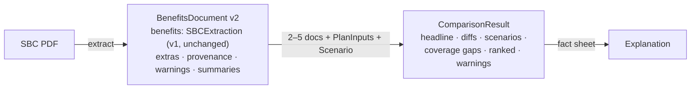

# Data contracts

Two contracts cross component boundaries: **BenefitsDocument** (extraction → summaries,
comparison, UI) and **ComparisonResult** (engine → explanation, UI). Both are Pydantic v2
models in `src/sbcx/schema/`. JSON Schema is generated from them for the API docs and for
LLM guided decoding.



## 1. Compatibility rule

`BenefitsDocument.benefits` **is** `schema.SBCExtraction`, unchanged. Every new field goes
into `extras`, `provenance` or `summaries`. So:

- `eval/score.py` scores parser output with no changes (`benefits` only).
- The 1,829 v1.4 labels and the gold labels stay valid test oracles.
- The fine-tuned SLM (if kept) still emits the same JSON.

## 2. BenefitsDocument v2

```python
# src/sbcx/schema/benefits.py
from datetime import datetime
from enum import Enum
from uuid import UUID
from pydantic import BaseModel, Field
from schema import SBCExtraction, Amounts   # existing v1 models

class Source(str, Enum):
    parser = "parser"
    parser_llm = "parser+llm"        # parser and LLM agreed
    llm_fallback = "llm_fallback"    # LLM overrode or filled a gap
    default = "default"              # convention-based default (e.g. column-shape rule)

class Versions(BaseModel):
    schema_version: str = "2.0"
    parser_version: str               # e.g. "2.0.0"
    guideline_version: str = "1.4"
    fallback_model: str | None = None

class FieldMeta(BaseModel):
    page: int | None                  # 1-based PDF page
    raw_text: str | None = Field(max_length=600)
    source: Source
    confidence: float = Field(ge=0, le=1)
    reasons: list[str] = []           # confidence penalties applied
    rule_trace: list[str] = []        # cell-parser rules that fired
    bbox: tuple[float, float, float, float] | None = None   # P1, for the PDF viewer

class DeductibleType(str, Enum):
    embedded = "embedded"
    aggregate = "aggregate"
    unknown = "unknown"

class CoverageExample(BaseModel):     # P1
    name: str                         # "Peg is Having a Baby"
    total_example_cost: float | None
    deductible: float | None
    copayments: float | None
    coinsurance: float | None
    limits_or_exclusions: float | None
    total_patient_pays: float | None

class BenefitsExtras(BaseModel):
    deductible_type: DeductibleType = DeductibleType.unknown
    other_deductibles: list[str] = []              # e.g. "$500 prescription drug deductible"
    limitations: dict[str, str] = {}               # service_key → limitations column text
    drug_limitations: str | None = None
    other_covered_services: list[str] = []
    coverage_examples: list[CoverageExample] = []
    template_profile: dict = {}                    # columns detected, IHCP, tiers
    anchored_services: int                         # out of 26

class Warning(BaseModel):
    code: str                                      # W_* (LLD §9)
    path: str | None = None
    message: str

class SectionSummary(BaseModel):
    section: str                                   # LLD §4.1 ids
    summary: str = Field(max_length=480)
    highlights: list[str] = Field(default=[], max_length=3)
    source: str                                    # "llm" | "template"
    model: str | None = None
    prompt_version: str

class BenefitsDocument(BaseModel):
    document_id: UUID
    sha256: str
    created_at: datetime
    versions: Versions
    benefits: SBCExtraction                        # v1 contract, unchanged
    extras: BenefitsExtras
    provenance: dict[str, FieldMeta]               # keyed by flat path (eval/score.py style)
    warnings: list[Warning] = []
    doc_confidence: float
    summaries: list[SectionSummary] = []
```

Provenance keys use the same flat paths as `eval/score.py`, e.g.
`services.specialist_visit.in_network.copay`, `drug_tiers[2].retail.in_network.coinsurance_pct`,
`deductible.in_network.family`.

### Example (abridged)

```json
{
  "document_id": "6f0c…",
  "sha256": "9b1e…",
  "versions": {"schema_version": "2.0", "parser_version": "2.0.0", "guideline_version": "1.4"},
  "benefits": {
    "plan_name": "Core Gold 1500", "issuer": "PacificSource", "plan_type": "EPO",
    "deductible": {"in_network": {"individual": 1500, "family": 3000}, "out_of_network": null},
    "services": {
      "primary_care_visit": {
        "in_network": {"covered": true, "copay": 25, "coinsurance_pct": null,
                       "deductible_applies": false,
                       "note": "First three visits $5 co-pay/visit, deductible does not apply."},
        "out_of_network": {"covered": false, "copay": null, "coinsurance_pct": null,
                           "deductible_applies": null, "note": null}
      }
    }
  },
  "extras": {
    "deductible_type": "embedded",
    "limitations": {"primary_care_visit": "First 3 visits per benefit year combined for primary care, mental health, behavioral health, and substance abuse visits."},
    "anchored_services": 26
  },
  "provenance": {
    "services.primary_care_visit.in_network.copay": {
      "page": 2, "source": "parser", "confidence": 0.9,
      "raw_text": "First three visits $5 co-pay/visit, deductible does not apply. Subsequent visits, $25 co-pay/visit, deductible does not apply.",
      "reasons": ["multi_part"], "rule_trace": ["first_visits_then_later_charge", "ded_flag:false"]
    }
  },
  "warnings": [],
  "doc_confidence": 0.97
}
```

## 3. Comparison inputs

```python
# src/sbcx/schema/comparison.py
class CoverageTier(str, Enum):
    individual = "individual"
    family = "family"

class PlanInputs(BaseModel):
    monthly_premium: float | None = Field(None, ge=0)   # None → premiums excluded, flagged
    employer_hsa_hra_annual: float = Field(0, ge=0)
    coverage_tier: CoverageTier = CoverageTier.individual

class Event(BaseModel):
    event: str                        # key in scenarios.yaml event_types
    count: int = Field(ge=1, le=365)
    member: int = 0                   # family member index (family tier only)

class Scenario(BaseModel):
    id: str                           # preset id or "custom"
    label: str
    events: list[Event]

class ComparisonRequest(BaseModel):
    base_document_id: UUID
    document_ids: list[UUID] = Field(max_length=4)
    catalog_plan_ids: list[str] = []
    inputs: dict[UUID | str, PlanInputs]
    scenario: Scenario | None = None          # selected; presets are always computed too
    reference_price_overrides: dict[str, float] = {}
    network: Literal["in_network", "out_of_network"] = "in_network"
    explain: bool = True
```

## 4. ComparisonResult

```python
class Verdict(str, Enum):
    better = "better"; worse = "worse"; same = "same"; not_comparable = "not_comparable"

class OverallVerdict(str, Enum):     # engine 1.3.0: before and after the deductible combined
    better = "better"; worse = "worse"; same = "same"
    depends_on_deductible = "depends_on_deductible"; not_comparable = "not_comparable"

class Money(BaseModel):              # a value that may be a range
    low: float
    high: float
    @property
    def exact(self) -> bool: return self.low == self.high

class PlanRef(BaseModel):
    plan_key: str                    # "A", "B", … stable within the comparison
    document_id: UUID
    plan_name: str | None
    issuer: str | None
    plan_type: str | None
    is_base: bool

class Headline(BaseModel):
    annual_premium: dict[str, float | None]
    employer_contribution: dict[str, float]
    deductible: dict[str, Amounts | None]         # selected network
    oop_limit: dict[str, Amounts | None]
    best_case: dict[str, float | None]            # premium − contribution
    worst_case: dict[str, float | None]           # + OOP limit (tier-appropriate)

class CellView(BaseModel):
    display: str                     # "$50 copay, deductible doesn't apply"
    est_cost_per_use: float | None   # one use once the deductible is met
    est_cost_before_deductible: Money | None = None   # one use before it is met (engine 1.3.0)
    deductible_status: str | None    # applies | does_not_apply | … | not_stated | none
    covered: bool | None
    deductible_applies: bool | None

class ServiceDiff(BaseModel):
    id: str                          # "svc.specialist_visit.in_network"
    service_key: str
    label: str                       # "Specialist visit"
    network: str
    cells: dict[str, CellView]       # plan_key → view
    verdicts: dict[str, Verdict]     # plan_key (non-base) → vs base, after the deductible
    delta_per_use: dict[str, float | None]   # plan − base
    verdicts_before_deductible: dict[str, Verdict] = {}      # engine 1.3.0
    overall_verdicts: dict[str, OverallVerdict] = {}         # engine 1.3.0; empty on older results
    comparison_kind: Literal["exact", "estimated"]
    flags: list[str] = []            # coverage_gap, deductible_difference, …
    reference_price: float | None

class DrugTierDiff(BaseModel):
    id: str
    category: str
    cells: dict[str, CellView | None]
    verdicts: dict[str, Verdict]
    verdicts_before_deductible: dict[str, Verdict] = {}
    overall_verdicts: dict[str, OverallVerdict] = {}

class LineItem(BaseModel):           # one event in the simulation trace
    event: str
    service_key: str
    allowed: float
    member_pays: float
    toward_deductible: float
    hit_oop_limit: bool

class ScenarioPlanResult(BaseModel):
    premiums: float | None
    contribution: float
    out_of_pocket: Money
    total: Money                     # premiums − contribution + out_of_pocket
    deductible_met: bool
    oop_limit_met: bool
    trace: list[LineItem]            # for "show your work" in the UI
    assumptions: list[str]

class ScenarioResult(BaseModel):
    scenario: Scenario
    per_plan: dict[str, ScenarioPlanResult]
    cheapest: list[str]              # plan_keys (ties possible; ranges overlapping → both)
    delta_vs_base: dict[str, Money]

class RankedDiff(BaseModel):
    diff_id: str
    impact_usd: float
    severity: Literal["high", "medium", "low"]

class ComparisonResult(BaseModel):
    comparison_id: UUID
    engine_version: str
    reference_prices_version: str
    plans: list[PlanRef]
    headline: Headline
    services: list[ServiceDiff]
    drug_tiers: list[DrugTierDiff]
    coverage_gaps: list[str]         # diff ids
    scenarios: list[ScenarioResult]  # presets + selected/custom
    ranked: list[RankedDiff]
    coverage_examples: dict[str, list[CoverageExample]] = {}   # P1, as stated by each SBC
    warnings: list[Warning]
    assumptions: list[str]
```

## 5. Explanation

```python
class ScenarioText(BaseModel):
    scenario: str
    text: str = Field(max_length=700)

class Explanation(BaseModel):
    headline: str = Field(max_length=200)
    key_points: list[str] = Field(min_length=3, max_length=5)
    scenarios: list[ScenarioText]
    watch_out: list[str] = Field(max_length=5)
    assumptions: list[str]
    disclaimer: str

class GroundingReport(BaseModel):
    ok: bool
    numbers_checked: int
    violations: list[str]            # "$1,240 not in fact sheet"
    policy_violations: list[str]

class ExplanationRecord(BaseModel):
    comparison_id: UUID
    content: Explanation
    source: Literal["llm", "llm_retry", "template"]
    grounding: GroundingReport
    model: str | None
    prompt_version: str
```

## 6. Versioning policy

| Change | Version bump | Effect |
|---|---|---|
| Parser rule fix | `parser_version` patch | Extractions marked stale, recomputed lazily |
| New field in `extras` | `schema_version` minor | Old docs read with defaults |
| Change in `SBCExtraction` | `schema_version` major + guideline version | Relabel / re-score gold and v1.4 |
| Cost formula change | `engine_version` | Old comparisons kept as they were; recompute on request |
| Prompt change | `prompt_version` | Summary/explanation cache miss |
