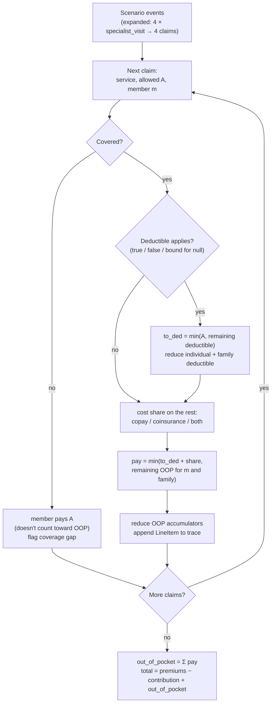

# Cost model: how money differences are calculated

This is the most sensitive part of the product. A wrong dollar figure in a confident
explanation is the worst thing the system can produce. So the rules here are
deterministic, versioned (`ENGINE_VERSION`), unit- and property-tested, and every result
carries its assumptions and a line-by-line trace.

## 1. What we compute

| Output | Formula | Notes |
|---|---|---|
| Annual premium | `monthly_premium × 12` | User input (or Rate PUF for catalog). Missing → excluded and flagged |
| Net fixed cost | `annual_premium − employer_hsa_hra_annual` | |
| **Best case** | net fixed cost | No care used |
| **Worst case** | net fixed cost + in-network OOP limit (tier-appropriate) | Excludes non-covered care and balance billing |
| Per-use cost of a service | `est_cost(cost_share, allowed)` (§3), deductible assumed met | For side-by-side cells |
| **Scenario annual cost** | net fixed cost + simulated out-of-pocket (§4) | Range when inputs are unknown |
| Δ vs base | `plan − base` per output | Precomputed so the LLM never does arithmetic |

## 2. Inputs

| Input | Source | Default |
|---|---|---|
| Cost-sharing per service/network | `BenefitsDocument.benefits.services` | — |
| Deductible, OOP limit (individual/family, in/out) | `benefits.deductible`, `benefits.out_of_pocket_limit` | — |
| Embedded vs aggregate family deductible | `extras.deductible_type` | unknown → both bounds |
| Drug tier cost-sharing | `benefits.drug_tiers` aligned by category | lowest-cost tier in category |
| Allowed amount per service ("price") | `config/reference_prices.yaml`, user overrides | illustrative national estimates |
| Usage | preset or custom scenario (`config/scenarios.yaml`) | presets low / moderate / high / baby |
| Premiums, employer HSA/HRA | user | none |
| Network | user | in-network |

## 3. Cost share for one claim

`A` = allowed amount of the claim; `D_rem` = remaining deductible for this member (and
family, see §5); `applies` = resolved deductible flag (§6).

```text
member_pays(cs, A, D_rem, applies):
    if cs is None or not cs.covered:
        return A, counts_toward_oop=False, gap=True
    to_ded = min(A, D_rem) if applies else 0
    rest   = A − to_ded
    share  = 0
    if rest > 0:
        if cs.copay is not None and cs.coinsurance_pct is not None:
            share = min(rest, cs.copay + max(0, rest − cs.copay) × pct)
        elif cs.copay is not None:
            share = min(cs.copay, rest)
        elif cs.coinsurance_pct is not None:
            share = rest × pct
        else:
            share = unknown → handled by bounds (low: 0, high: rest)
    return to_ded + share, counts_toward_oop=True
```

`pct = coinsurance_pct / 100`. A copay is never more than the allowed amount.

## 4. Annual simulation



```python
def simulate(plan, extras, inputs, scenario, prices, bound) -> ScenarioPlanResult:
    acc = Accumulators.for_tier(plan, extras, inputs.coverage_tier, bound)
    trace = []
    for claim in expand(scenario, prices, plan):          # deterministic order
        cs = cell(plan, claim.service, network)
        applies = resolve_deductible(cs, plan, bound)
        pay, counts, gap = member_pays(cs, claim.allowed, acc.ded_remaining(claim.member), applies)
        if counts:
            acc.apply_deductible(claim.member, min(claim.allowed, acc.ded_remaining(claim.member)) if applies else 0)
            pay = min(pay, acc.oop_remaining(claim.member))
            acc.apply_oop(claim.member, pay)
        trace.append(LineItem(...))
    oop = sum(li.member_pays for li in trace)
    return ScenarioPlanResult(out_of_pocket=oop, total=net_fixed + oop, trace=trace, ...)
```

**Order.** Claims are processed in the scenario's listed order. For most plans the total
does not depend on order (deductible-subject claims share one coinsurance rate, and the OOP
cap applies to the total). It can matter when deductible-subject services have different
coinsurance rates, or copays apply after the deductible. Presets are written in a typical
order, and the order is part of the scenario definition, so results are reproducible.

## 5. Individual vs family

| `deductible_type` | Deductible accumulators | OOP accumulators |
|---|---|---|
| `embedded` | each member: individual amount; family: family amount; a claim reduces both; a member stops paying deductible when either reaches 0 | same structure |
| `aggregate` | family amount only; every member's claims reduce it | ACA requires an embedded individual OOP limit for family coverage, so OOP is still per member + family |
| `unknown` | run both, take min as low and max as high | |

Individual coverage tier: only the individual amounts are used.

## 6. Unknown inputs become ranges

The extractor keeps three-valued flags (`null` = the document doesn't say). The cost engine
doesn't guess. It computes bounds:

| Unknown | Low bound | High bound | Warning |
|---|---|---|---|
| `deductible_applies = null` on a covered cell with a price | `false` | `true` | `W_RANGE_DEDUCTIBLE_UNKNOWN` |
| Covered, no copay/coinsurance stated | member pays 0 after deductible | member pays all of it | `W_PRICE_UNKNOWN` |
| `deductible_type = unknown` (family tier) | min(embedded, aggregate) | max(…) | `W_FAMILY_TIER_UNKNOWN` |
| Missing family amount | individual × 2 | — (flag only) | `W_FAMILY_AMOUNT_MISSING` |
| OOP limit null in network used | no cap | no cap | `W_NO_OOP_LIMIT` |

When the deductible is 0, `deductible_applies` doesn't matter and no range is produced.
If two plans' ranges overlap, `cheapest` lists both and the explanation must say "depends".

## 7. Comparing a copay with a coinsurance

"$50 copay" vs "20% after deductible" can't be compared without a price. The engine
converts both with the reference allowed amount for that service and marks the diff
`comparison_kind = "estimated"`. The UI shows the reference price and lets the user change it.
Exact comparisons (copay vs copay, % vs %) need no price.

## 8. Worked example

Two fictional plans, individual coverage, in-network, moderate scenario. Reference prices
are illustrative.

**Reference allowed amounts:** preventive $250 · primary care $150 · specialist $250 ·
lab $120 · MRI $1,000 · generic fill $30 · urgent care $200.

| | Plan A (base, Gold) | Plan B (HDHP) |
|---|---|---|
| Premium | $500/mo → $6,000/yr | $380/mo → $4,560/yr |
| Employer HSA | — | $500 |
| Deductible / OOP limit | $1,500 / $9,300 | $3,500 / $7,000 |
| Preventive | No charge | No charge |
| Primary care | $25 copay, deductible doesn't apply | 20% after deductible |
| Specialist | $50 copay, deductible doesn't apply | 20% after deductible |
| Lab, MRI | 20% coinsurance, **deductible not stated** | 20% after deductible |
| Generic drug | $25 copay, deductible doesn't apply | $10 copay after deductible |
| Urgent care | $25 copay, deductible doesn't apply | 20% after deductible |

**Moderate scenario:** 1 preventive, 3 primary care, 4 specialist, 2 lab, 1 MRI, 12 generic
fills, 1 urgent care.

**Plan A:**

| Claims | Low bound (deductible doesn't apply to lab/MRI) | High bound (it does) |
|---|---|---|
| Preventive | $0 | $0 |
| 3 × primary care @ $25 | $75 | $75 |
| 4 × specialist @ $50 | $200 | $200 |
| 2 × lab ($120) | 20% → $48 | all $240 to deductible |
| MRI ($1,000) | 20% → $200 | all $1,000 to deductible (remaining $260) |
| 12 × generic @ $25 | $300 | $300 |
| Urgent care | $25 | $25 |
| **Out of pocket** | **$848** | **$1,840** |
| **Total (+ $6,000 premium)** | **$6,848** | **$7,840** |

**Plan B:** every claim is subject to the $3,500 deductible. Allowed amounts total
$450 + $1,000 + $240 + $1,000 + $360 + $200 = **$3,250**, which is below the deductible, so
the member pays all of it. Total = $4,560 − $500 + $3,250 = **$7,310**.

**Result:**

| | Plan A | Plan B | B − A |
|---|---|---|---|
| Best case | $6,000 | $4,060 | −$1,940 |
| Moderate scenario | $6,848 – $7,840 | $7,310 | −$530 to +$462 |
| Worst case | $15,300 | $11,060 | −$4,240 |

The ranges overlap, so the honest answer for moderate use is "about the same; it depends
on whether Plan A's deductible applies to lab work and imaging, which its SBC doesn't say".
Plan B is cheaper in the best and worst cases. That is what the explanation LLM receives:
already computed, with the uncertainty explicit.

## 9. What v2.0 does not model (stated in `assumptions`)

- Balance billing and out-of-network allowed amounts (out-of-network results are flagged as low-confidence).
- Separate drug or service deductibles (`extras.other_deductibles` → warning `W_SEPARATE_DEDUCTIBLE_NOT_MODELED`).
- Visit limits and "first N visits" pricing in notes (the structured, later charge is used).
- Copays that count toward the deductible, carry-over, and plan-year boundaries.
- Premium tax credits, HSA tax savings, prior-authorization penalties.
- Regional price variation (one national table; a regional multiplier is a v2.2 candidate).

## 10. Tests specific to the cost model

See [07-evaluation-and-testing](07-evaluation-and-testing.md) §4. Highlights:

- The worked example above is a unit test.
- Property tests: total ≤ net fixed cost + OOP limit (covered care); low ≤ high;
  raising a copay never lowers cost; adding a claim never lowers cost; `deductible = 0` gives
  low = high.
- **Calibration against the SBC's own coverage examples (P1):** run the CMS coverage-example
  claim lists (Peg / Joe / Mia) through the engine with each plan's extraction and compare with
  the "total Peg would pay" figure printed in that SBC. Large mismatches point to an
  extraction error or a missing rule. This checks both extractor and engine on every
  catalog document, without labels.
