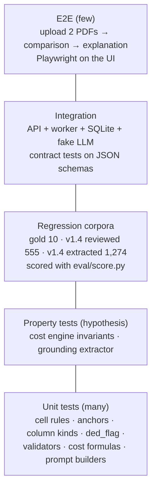
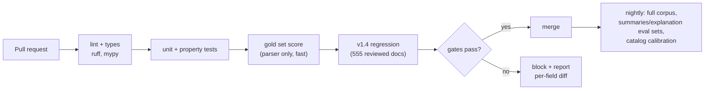

# Evaluation and testing

v2 has five things that can be wrong in different ways. Each gets its own test set, metric
and gate.

| Layer | What can go wrong | Oracle | Gate (CI blocks merge) |
|---|---|---|---|
| Extraction (parser + fallback) | wrong / missing / invented values | gold (10, PDF-verified), v1.4 reviewed (450 + 105 val) | gold field acc ≥ 98%, hallucination ≤ 1%; no regression > 0.3 pt on v1.4 |
| Section summaries | ungrounded numbers, misleading wording | grounding validator, LLM judge, human sample | grounding 100% after fallback; judge ≥ 4/5 faithfulness on 50-doc sample |
| Comparison + cost engine | arithmetic or rule errors | hand-computed cases, property tests, SBC coverage examples | 100% unit + property pass |
| Explanation | ungrounded numbers, advice, omissions | grounding + policy validators, judge rubric | first-try grounding ≥ 95%; 0 policy violations served |
| System | latency, cost, failures | load tests, metrics | p95 targets in PRD §6 |

## 1. Test pyramid



## 2. Extraction

### 2.1 Data

| Set | Size | Use |
|---|---|---|
| `data/gold/labels` | 10 docs, ~2.6k fields, PDF-verified | Acceptance. Never used to tune rules |
| `data/labels/v1.4` status=reviewed | 450 docs | Development and regression |
| v1.4 val, cell-reviewed (`audit_tools/valrev.json`) | 105 docs | Held-out regression (report separately) |
| v1.4 status=extracted (rest) | ~1,274 docs | Smoke: crash-free, anchoring coverage, warning rates |
| Catalog (no labels) | up to 14k | Self-consistency: business rules, coverage-example calibration |

Caveat: v1.4 base labels were produced by the prototype extractor itself, then corrected.
Agreement with them partly measures "same as the prototype". That's why the gold set and the
cell-reviewed val subset are the acceptance numbers, and `_corrections.jsonl` diffs (places
where humans/LLM review overrode the prototype) are the most valuable regression cases.

### 2.2 Metrics

Reuse `eval/score.py` unchanged on `BenefitsDocument.benefits`:
field accuracy, hallucination, omission, per-group (money, percent, covered,
deductible_applies, plan_info, drug_tier_category), list F1. Add:

- **Anchoring coverage:** services anchored / 26, per issuer family.
- **Fallback rate:** % docs and % cells sent to the LLM; accuracy of fallback cells vs parser-only.
- **Confidence calibration:** accuracy per confidence bucket (should be monotonic); used to pick τ.
- **Per-family breakdown:** 49+ template families; the worst family is reported on every run.

### 2.3 Rule tests from corrections

Every fix block in `audit_tools/fix/*.txt` and every entry in `data/labels/v1.4/_corrections.jsonl`
encodes a cell the prototype got wrong. Port them to parametrized tests:

```python
@pytest.mark.parametrize("raw, expected", load_cell_cases("tests/cases/cells.jsonl"))
def test_parse_cost(raw, expected):
    cost, _ = parse_cost(raw)
    assert cost == CostShare(**expected)
```

Seed cases (already known from the v1.4 conventions): "First 3 visits $5, then $25" →
copay 25; "$250 copay then 20% coinsurance" → both; "$300 Preferred Brand; 40%
Non-Preferred" → copay 300 + note; "0% coinsurance" → copay null; "Not Covered" → NC;
legend "†" deductible flags; IHCP 3-column tables; Tier 1/Tier 2 networks.

### 2.4 Baseline comparison (report in README results table)

| System | Field acc. | Halluc. | Latency/doc | Cost/doc |
|---|---|---|---|---|
| Teacher DeepSeek V4 Flash + repair | 97.6% | 3.9% | ~50 s | ~$0.0015 |
| Qwen3-4B zero-shot | 74.7% | 36.5% | ~184 s | local |
| **v2 parser only** | _to measure_ | | target < 2 s | $0 |
| **v2 parser + fallback** | target ≥ 98% | target ≤ 1% | target < 8 s | < $0.0002 |

## 3. Section summaries

| Check | How | Target |
|---|---|---|
| Numeric grounding | validator (LLD §4.3) on every summary | 100% served (fallback covers failures); first-try ≥ 95% |
| Faithfulness | LLM judge (stronger model) with the section JSON: "does any statement contradict or go beyond the input?" 1–5 | mean ≥ 4.5 on 50 docs × 13 sections |
| Usefulness / clarity | judge rubric + 20-doc human read | ≥ 4/5 |
| Length / style | word count ≤ 60, no "you should", reading grade ≤ 9 (Flesch-Kincaid) | 100% |
| Null handling | adversarial cases with `deductible_applies=null`, `not covered`, empty limitations | no invented claims |

## 4. Comparison and cost engine

- **Hand-computed unit tests:** the worked example in [06-cost-model §8](06-cost-model.md);
  one test per row of the cost-share formula; family embedded vs aggregate; OOP cap hit
  mid-claim; not-covered claim doesn't count toward OOP; deductible exactly met.
- **Property tests (hypothesis)** over random plans and scenarios:
  - `low ≤ high` for every result.
  - out-of-pocket for covered care ≤ OOP limit.
  - Monotonicity: adding a claim, raising a copay/coinsurance/deductible or lowering the OOP limit never lowers the total.
  - `deductible = 0` ⇒ low == high.
  - Determinism: same inputs ⇒ identical JSON (hash).
  - Δ vs base equals plan − base exactly.
- **Coverage-example calibration (P1):** engine total for Peg/Joe/Mia vs the SBC's printed
  total, on all catalog docs with parsed examples. Track % within $50; investigate outliers.
- **Golden comparisons:** 10 hand-checked plan pairs (snapshot of `ComparisonResult`); diffs
  require review when the engine version changes.

## 5. Explanation

| Check | How | Target |
|---|---|---|
| Numeric grounding | validator vs fact sheet | 100% served; first-try ≥ 95% |
| Policy | regex + judge: no advice, no guarantees, disclaimer present | 0 violations served |
| Coverage of what matters | top-3 ranked diffs and every coverage gap mentioned | ≥ 95% |
| Correct direction | every "cheaper / more" claim matches `cheapest` / Δ sign; overlapping ranges described as "depends" | 100% (rule check on scenario texts) |
| Readability | judge + reading grade ≤ 9 | ≥ 4/5 |
| Robustness | fact sheets with 2 vs 5 plans, all-ranges, missing premiums, identical plans | no crash, sensible text |

The eval set: 30 comparison fact sheets (from gold + v1.4 docs, a mix of scenarios),
frozen in `eval/explanations/`. Each prompt or model change runs the full set; results are
reported like extraction runs.

## 6. Non-functional

- **Load:** Locust, 20 concurrent users uploading 2 PDFs and comparing; check p95 per stage.
- **Chaos:** LLM provider returns 500 / times out / returns invalid JSON → system still returns extraction, comparison and template explanation.
- **Security:** fuzzed and malformed PDFs (zip bombs, huge pages, encrypted) handled within limits; prompt-injection strings in limitations text don't change numbers in summaries.

## 7. CI pipeline



Fast path: layout JSON for gold and v1.4 docs is cached (`data/layout_cache/`, gitignored),
so the regression job runs parser logic only and takes about a minute.
