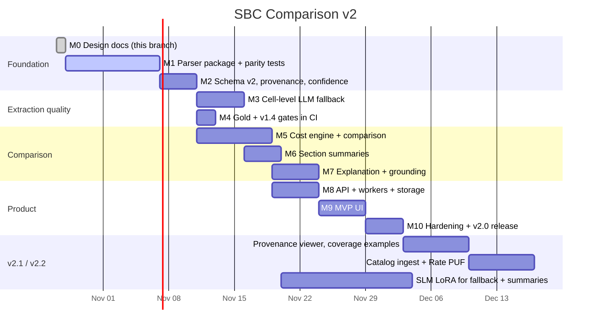

# Implementation plan

Milestones are ordered so that something usable and measurable exists after each one.
Durations assume one developer working with Claude Code; adjust as needed.

## 1. Timeline

## 2. Milestones

### M1 — Parser package with parity tests

Turn the prototype in `audit_tools/` into `src/sbcx/parse/`.

- Port `textnorm` (`norm`, `dejunk`), `cells` (`parse_cost`, `ded_flag`), `anchors`
  (`extract`), `columns` (`colkinds`), `lists` (`excl.py`), `drugs`, `header`, `questions`
  (from `mk.py`). Replace hard-coded `~/audit/` paths with function arguments.
- Make `layout.py` produce both views (pdfplumber tables from `tables.py`, cleaned markdown
  from `mdclean.py`) and cache per SHA-256.
- Add `extract/pipeline.py`: `extract(pdf_bytes) -> SBCExtraction`.
- Tests: cell cases from the v1.4 conventions and `_corrections.jsonl`; anchoring edge cases.
- **Done when:** `uv run python -m sbcx.cli extract <pdf>` works; gold and v1.4 reviewed
  scores are reported with `eval/score.py` (new run folder `eval/predictions/parser_v2.0.0`).
  Target ≥ 97% gold field accuracy before M3.

### M2 — Schema v2, provenance, confidence

- `schema/benefits.py` (BenefitsDocument, extras, FieldMeta) per [05-data-contracts](05-data-contracts.md).
- Capture page + raw text + rule trace per field; limitations text per service; `deductible_type`.
- `rules.py` warnings; `confidence.py` penalties; calibration plot on v1.4 to pick τ.
- **Done when:** every field has provenance; accuracy per confidence bucket is monotonic.

### M3 — Cell-level LLM fallback

- `llm/client.py` with OpenRouter provider first (reuses `label_sbcs.py` setup), vLLM provider stub.
- `extract/fallback.py`: batching, prompt, guided JSON, grounding, reconciliation table.
- **Done when:** gold ≥ 98% / ≤ 1% hallucination; ≥ 90% of docs need no fallback; fallback cost reported.

### M4 — CI gates

- GitHub Actions: ruff, mypy, pytest, gold score, v1.4 regression with cached layouts.

### M5 — Cost engine and comparison

- `compare/` modules; `config/scenarios.yaml`, `reference_prices.yaml`, `legal_limits.yaml`.
- Unit tests for the worked example, property tests (hypothesis), 10 golden comparisons.
- CLI: `sbcx compare a.pdf b.pdf --premium a=500 --premium b=380 --hsa b=500 --scenario moderate`.
- **Done when:** all invariants pass; `ComparisonResult` JSON is deterministic.

### M6 — Section summaries

- `enrich/summarize.py`, prompt `summary.v1.md`, grounding validator, template fallback, cache.
- Eval: 50-doc judge run.
- **Done when:** 100% grounded output served; judge faithfulness ≥ 4.5.

### M7 — Explanation

- `explain/factsheet.py`, `generate.py`, `policy.py`, Jinja fallback template.
- Eval set of 30 fact sheets in `eval/explanations/`.
- **Done when:** first-try grounding ≥ 95%, 0 policy violations served.

### M8 — API, workers, storage

- FastAPI routes per LLD §8; SQLite via SQLAlchemy (Postgres-ready); BackgroundTasks as the queue for MVP; SSE.

### M9 — MVP UI

- Streamlit (fastest path) in `app/`: upload, benefits view with section summaries, comparison table, scenario picker, premium inputs, cost chart, explanation, warnings.

### M10 — Hardening

- Load test, chaos test (LLM down), PDF fuzzing, observability (structured logs, per-stage timings, LLM cost log), README update, results table.

## 3. Work breakdown (first two milestones in detail)

| # | Task | Output | Est. |
|---|---|---|---|
| 1.1 | Create `src/sbcx/` skeleton, `versions.py`, pytest config | package | 0.5 d |
| 1.2 | Port `norm`/`dejunk` + tests | `parse/textnorm.py` | 0.5 d |
| 1.3 | Port `parse_cost`, `ded_flag`; convert rules to named rules with traces | `parse/cells.py` | 2 d |
| 1.4 | Mine cell test cases from `_corrections.jsonl` + fix files | `tests/cases/cells.jsonl` | 1 d |
| 1.5 | Port `extract()` anchoring, `colkinds`, packed rows, continuations | `parse/anchors.py`, `columns.py` | 2 d |
| 1.6 | Port header / questions (`mk.py`) and lists (`excl.py`), drugs | 4 modules | 1.5 d |
| 1.7 | Layout dual view + cache | `parse/layout.py` | 1 d |
| 1.8 | Pipeline + CLI + score on gold and v1.4 | `eval/predictions/parser_v2.0.0` | 1 d |
| 1.9 | Triage worst families, fix rules, re-score | rule fixes + tests | 1.5 d |
| 2.1 | BenefitsDocument models + JSON schema export | `schema/benefits.py` | 0.5 d |
| 2.2 | Provenance capture through the pipeline | provenance dict | 1 d |
| 2.3 | `deductible_type`, limitations capture | extras | 0.5 d |
| 2.4 | Business rules + confidence + calibration notebook | `rules.py`, `confidence.py` | 2 d |

## 4. What happens to existing work

| Area | Decision |
|---|---|
| `src/` labeling pipeline, gold set, `eval/score.py` | Kept. The gold set becomes the acceptance test for the parser |
| `audit_tools/` | Source for the port. After M1, the useful parts live in `src/sbcx/`; the folder stays for history (or is moved to `archive/`) |
| `data/labels/v1.4` | Regression corpus; also the source of (cell → CostShare) training pairs for the fallback SLM |
| `training/` QLoRA + Kaggle notebook | Paused for full-document extraction; retargeted to two small LoRA tasks: cell fallback and section summaries (ADR-009). The doc-level fine-tune can still be finished as a benchmark if wanted |
| Phase 5–6 (quantization, vLLM on Modal) | Still relevant: serve the summarizer/fallback SLM with multi-LoRA |
| README roadmap | Update after this design is approved |

## 5. Risks

| Risk | Likelihood | Impact | Mitigation |
|---|---|---|---|
| Layout long tail (new insurer templates) breaks anchoring | Medium | Medium | Lookahead anchoring, dual layout views, cell/row fallback, per-family dashboards, catalog smoke runs |
| Rules overfit to v1.4 corpus | Medium | Medium | Gold + cell-reviewed val held out; new families from catalog as fresh test |
| Reference prices look authoritative but are rough | High | High | Labeled as estimates, user-editable, ranges shown, sources recorded in config |
| LLM writes a wrong number | Medium | High | Fact sheet with precomputed values + grounding validator + template fallback |
| Users read output as advice | Medium | High | Policy validator, disclaimer, neutral wording rules |
| `deductible_applies = null` is common, so many results are ranges | High | Medium | Honest ranges; P1: use page-1 "services before deductible" list as evidence to narrow ranges (engine only, not extraction) |
| Scanned SBCs | Low–Medium | Low | Detect and reject in v2.0; OCR/vision fallback later |
| Scope creep into networks/formularies | Medium | Medium | Non-goals in PRD |
