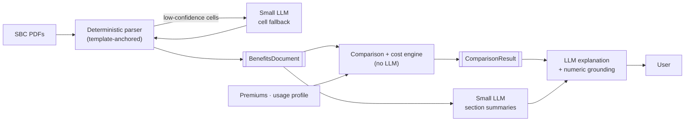

# Design v2: deterministic extraction, LLM explanations

**Status:** proposed (branch `design/v2-hybrid-pipeline`, 2026-10-27)

**In one sentence:** Python reads the SBC and does all the math; small LLMs only re-read
cells the parser is unsure about and write summaries; an LLM turns the computed
comparison into a plain-language explanation, and a validator rejects any number it didn't receive.

## Documents

| # | Document | What's in it |
|---|---|---|
| 01 | [PRD](01-PRD.md) | Problem, goals, personas, user stories, requirements, metrics, open questions |
| 02 | [Architecture](02-architecture.md) | Principles, system context, containers, data flow, LLM usage map, deployment, repo mapping |
| 03 | [HLD](03-HLD.md) | Components, sequence diagrams (upload, summaries, compare + explain, fallback, catalog), lifecycle, failure handling, cross-cutting concerns |
| 04 | [LLD](04-LLD.md) | Package layout, class diagram, parser algorithms, confidence, fallback, prompts, grounding, engine, API, error codes, DB schema |
| 05 | [Data contracts](05-data-contracts.md) | `BenefitsDocument v2`, `ComparisonRequest`, `ComparisonResult`, `Explanation`, versioning |
| 06 | [Cost model](06-cost-model.md) | Formulas, annual simulation, family rules, ranges for unknowns, worked example |
| 07 | [Evaluation & testing](07-evaluation-and-testing.md) | Test sets, metrics, gates, property tests, LLM output evals, CI |
| 08 | [Implementation plan](08-implementation-plan.md) | Milestones, timeline, work breakdown, what happens to existing work, risks |
| 09 | [Decisions](09-decisions.md) | ADR-001 … ADR-011 |

## Decisions that need your input

From [PRD §9](01-PRD.md#9-open-questions):

1. Compare uploads only, or uploads + the marketplace catalog? (default: uploads first)
2. Explanation model: hosted or self-hosted SLM? (default: hosted, behind a provider-agnostic client)
3. Keep finishing the full-document fine-tune, or retarget training to cell fallback + summaries? (default: retarget, ADR-009)
4. Where reference allowed amounts come from. (default: illustrative YAML, user-editable)
